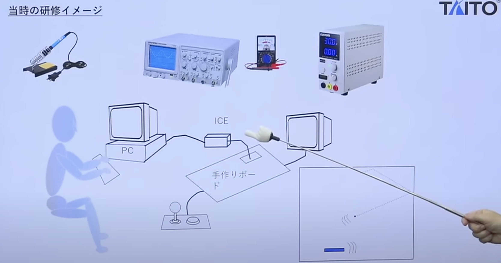

# Arcade hardware, code and preservation
Arcade games are tied to physical boards: changing the program can mean replacing a ROM, while recreating a game may require understanding separate graphics, sound and timing chips. The examples below move from the earliest wired logic to surviving source code and MAME board descriptions.

## What was the first arcade video game?


**Computer Space**, released in 1971 by **Nolan Bushnell** and **Ted Dabney**, is widely described as the first commercially sold arcade video game. Its creators later founded **Atari** and made **Pong** [^12].

Its fiberglass cabinet looked unlike the wooden cabinets that followed. The photograph above shows Archer Maclean restoring one.

Despite its name, *Computer Space* did not run a stored program on a CPU. Its game logic was built from TTL chips and their connections; changing that logic meant changing hardware rather than patching a ROM [^17].

---
# Development of Arcade Games

---
## Pac-Man's kill screen
[Retro Game Mechanics Explained](https://www.youtube.com/watch?v=NKKfW8X9uYk) explains Pac-Man's kill screen as a game-implementation problem. It is a compact case study for connecting visible arcade behaviour to the code and data behind it.

<iframe width="560" height="315" src="https://www.youtube.com/embed/NKKfW8X9uYk" title="Pac-Man Kill Screen Explained" loading="lazy" frameborder="0" allow="accelerometer; autoplay; clipboard-write; encrypted-media; gyroscope; picture-in-picture; web-share" referrerpolicy="strict-origin-when-cross-origin" allowfullscreen style="max-width:100%;height:auto;aspect-ratio:16/9;"></iframe>

## What programming languages were used to create Arcade games?
Early boards such as *Computer Space* expressed game rules in hardware. Once arcade boards adopted microprocessors, programmers could write assembly for the board's CPU or use a higher-level language when the toolchain and performance budget allowed it.

For example the 1990 game **Klax** was written in C according to **Greg Omi** who was sent the source code for his Atari Lynx port of the game [^4].

This is further confirmed in a 1990 interview with original designer of Klax **Mark Stephen Pierce**[^5]:
> "All Atari coin‑ops today are written in C ‑ that's the most popular language with the programmers here, I guess. The actual programming work is carried out on standard terminals, and then transferred into our VAX machines where it's compiled and compressed.  Finally it's downloaded from there through an EPROM burner and onto the hardware for the game that the engineer has put together. Every coin‑op's hardware is different partly because each game is different, and partly as a form of copy protection.


## What tools were used to create the art for Arcade games?
In the 1990 interview with **Mark Stephen Pierce** the following was published (in "The One" magazine) [^5]:
> Mark's graphics are produced on a PC ‑ but using Atari's own specially written utility: RAD (Rendering and Animation Design). "It's basically a standard paint tool with some animation facilities. I design and draw on the PC before uploading everything to the VAX to be compressed."


## What did a Typical Arcade Game Development Team Look Like?
A cabinet could involve people working on electronics, code, controls, art and sound. Taito's 1987 *Darius* offers one named example; its three-screen presentation and custom cabinet make the hardware role especially visible. The [translated developer interviews](https://shmuplations.com/dariusii/) identify these contributors:
* **Sound Designer** – Yasuhiko Tanaka
* **Composer** – Hisayoshi "OGR" Ogura
* **Cabinet Designer** – Natsuki Hirosawa
* **Game Designer** – Junji Yarita
* **Planner** – Akira Fujita
* **Programmer** – Toru Sugawara
* **Hardware Engineer** – Takeki Nakamura

The interviews describe this project, not a standard team size for every arcade game.

## How long did it take to develop an Arcade game?
In 1990 Atari developer **Mark Stephen Pierce** had the following to say about the length of time for developing an Arcade game:
> An Atari game takes, on average, around a year to produce ‑ but then an average can come from two extremes, which is certainly in Mark's case - Escape took over two years to put together, whereas Klax was written in just four months!

## How were Arcade games tested?
Difficulty and coin use mattered to arcade operators. In a 1990 Atari interview, Mark Stephen Pierce describes placing prototypes in arcades, recording play and tracking receipts to see how people responded [^5]. That is evidence of Atari's process at the time, rather than a rule for every studio.

---
# Arcade Development Hardware

---
## Tempest ROM hacking and EPROMs
[Dave's Garage](https://www.youtube.com/watch?v=BjsVSEbXDOM) introduces Tempest video-game hacking and EPROMs. The tutorial connects changes to an arcade program with the physical chips that store it.

<iframe width="560" height="315" src="https://www.youtube.com/embed/BjsVSEbXDOM" title="01-Tempest Video Game Hacking - Introduction and EPROMS" loading="lazy" frameborder="0" allow="accelerometer; autoplay; clipboard-write; encrypted-media; gyroscope; picture-in-picture; web-share" referrerpolicy="strict-origin-when-cross-origin" allowfullscreen style="max-width:100%;height:auto;aspect-ratio:16/9;"></iframe>

## Game Development at Taito
Taito put together a **250-page Hardware Manual** for new developers who joined the team to learn how to create an Arcade game from scratch using RAM/ROM/CPU chips and a standard TV. This was before the internet and even before there were many books on the topic when the industry was very new and companies didn't want to share their "trade secrets".

<blockquote class="twitter-tweet" data-media-max-width="560"><p lang="en" dir="ltr">With the Taito Hardware Manual for reference, new engineers were sent out to Akihabara to get some ROM and RAM chips and a CPU, solder them all together onto a test PCB, then write a brick breaker game.<a href="https://t.co/huXblA0rv4">https://t.co/huXblA0rv4</a><a href="https://t.co/CXlnKUPHkH">https://t.co/CXlnKUPHkH</a> <a href="https://t.co/Yip45KbLIE">pic.twitter.com/Yip45KbLIE</a></p>&mdash; Taito Corporation (@TaitoCorp) <a href="https://twitter.com/TaitoCorp/status/1748438175977226708?ref_src=twsrc%5Etfw">January 19, 2024</a></blockquote>

The diagram shows an in-circuit emulator connected to the prototype board for debugging:


---
## Development of RoboTron (1981)
At GDC 2014 **Eugene Jarvis** gives an excellent presentation about the development of Robotron:
<iframe width="560" height="315" src="https://www.youtube.com/embed/8AbiBOK8jZ0?si=1ftjO79ry3ld1i6u" title="YouTube video player" frameborder="0" allow="accelerometer; autoplay; clipboard-write; encrypted-media; gyroscope; picture-in-picture; web-share" referrerpolicy="strict-origin-when-cross-origin" allowfullscreen></iframe>

They used the **Gimix 6809** as their development system:


As for the software side, they had to write their own text editor and assembler, they didn't comment or use tabs as every byte that was used in memory was precious:


In Retro Gamer 28 there is an excellent article from **Archer Maclean** where he went to a presentation by **Eugene Jarvis** and this is what he had to say [^3]:
> He went on to describe that his code spilled over into multiple files on more
than one floppy, and yet there were no multi-floppy code-linkers so he devised the exact same bizarre jump vector solution I had devised to allow non-linked blocks of code to communicate.
> Then he described how he had to write 'utilities' to edit tiny bitmaps drawn on graph paper and entered as hex,
> and how to get around the one hour compile times by editing memory directly and disassembling in your head,
> and how to make interesting sounds from 30 bytes of data, and how to write ultra-tight optimised machine code to move small bitmaps around a screen fast, and off course, cram it all into a 32k ROM.

---
# Arcade Game Source Code

## Defender (1981 by Williams Electronics)
The source code for the classic arcade game from 1981 **Defender** has been released on Github:
[mwenge/defender: Defender(1981) by Eugene Jarvis and Sam Dicker](https://github.com/mwenge/defender)

It is written in a variant of the Assembly language specifically for the Motorola 6809 CPU [^1].

The physical board had 11 ROM chips on it that would need to be flashed with the assembled result of that source code [^1].

Defender was developed by **Eugene Jarvis** and **Larry DeMar** two programmers who utilized algorithms to great effect rather than relying on artists, one such example is the classic explosion particle effect. Defender became one of the highest grossing arcade games in history [^2].

The first issue of the Magazine Wireframe contains a python (pygame) code snippet to re-create the classic particle explosion from Defender [^2]. You can find that code on github too: [https://github.com/Wireframe-Magazine/Wireframe-1/blob/master/explosion.py](https://github.com/Wireframe-Magazine/Wireframe-1/blob/master/explosion.py)


---
## Acrobat Mission Rank Analysis
Pasky's [Acrobat Mission Ghidra analysis](https://x.com/TheRealPasky/status/2113201618447425646) connects the shooter's difficulty system to specific game-state values rather than relying on perceived difficulty.
The thread reports a separate rank from 0 to 7 for each player, with starting values set by the difficulty DIP switches. Rank rises every 1,800 play updates, approximately 30 seconds at 60 Hz [^13].

According to the analysis, higher rank reduces some shot damage and changes charged-shot hit-check intervals rather than increasing enemy health.
For the World version, Pasky identifies player rank at `0x80270` and `0x80292`, with timers at `0x80272` and `0x80294`. These are author-reported findings for that version, not addresses established for every release [^13].

---
# Speed Up Kits
Speed-up kits, also known as **enhancement kits**, were aftermarket hardware modifications designed to alter the behavior of arcade games. These kits typically increased game speed, introduced new features, or adjusted difficulty levels. By modifying the original game code or hardware, speed-up kits aimed to rejuvenate player interest and extend the commercial lifespan of arcade cabinets.

## Purpose and Impact of Speed Up Kits
The primary motivations for implementing speed-up kits included:
* **Increased Revenue**: Faster gameplay reduced session times, allowing more players per hour and increasing coin drop rates.
* **Extended Cabinet Life**: By refreshing game mechanics, operators could delay purchasing new machines.
* **Enhanced Player Engagement**: New challenges and features kept experienced players interested.

For example, the original **Asteroids** game allowed skilled players to play indefinitely on a single credit. A speed-up kit made the game more challenging, thereby reducing playtime per credit and increasing revenue .

---
## Notable Examples

<iframe width="560" height="315" src="https://www.youtube.com/embed/rhM8NAMW_VQ?si=hHhQDzRVGSHGOtsp" title="YouTube video player" frameborder="0" allow="accelerometer; autoplay; clipboard-write; encrypted-media; gyroscope; picture-in-picture; web-share" referrerpolicy="strict-origin-when-cross-origin" allowfullscreen></iframe>

Some of the most famous examples of speed up kits are:
* **Super Missile Attack**: Developed by General Computer Corporation (GCC), this kit modified Atari's *Missile Command*, adding new enemies and increasing difficulty. Its success led to legal action from Atari, which was eventually settled when Atari hired GCC to develop games .
* **Ms Pac Man**: Another GCC project, this kit transformed Namco's **Pac-Man** into **Crazy Otto**, introducing new mazes and improved AI. Midway licensed and released it as an official sequel called **Ms Pac Man** [^6].

---
## How were Speed Up Kits implemented?
Speed-up kits were typically implemented through reverse engineering the original game and modifying it using:

* **Daughterboards**: Additional circuit boards that modified signals or data paths.
* **ROM Replacements**: Swapping out original ROM chips with modified versions containing new code.
* **Clock Modifications**: Altering the system clock to increase CPU speed, thus speeding up gameplay .

---
## Legal and Ethical Considerations
While speed-up kits offered benefits to arcade operators, they raised legal and ethical questions:

* **Intellectual Property**: Modifying and distributing altered versions of games without permission infringed on the original developers' rights.
* **Quality Control**: Unauthorized modifications could lead to inconsistent gameplay experiences and potential hardware issues.

The legal dispute between Atari and GCC over **Super Missile Attack** highlighted these concerns. The settlement resulted in GCC ceasing unauthorized modifications and instead developing licensed content resulting in **Ms Pac Man** [^6].

---
## Legacy of Speed Up Kits
Speed-up kits played a significant role in the arcade industry's evolution:

* **Innovation Catalyst**: They demonstrated the demand for game enhancements, influencing official sequels and updates.
* **Technical Advancement**: The reverse engineering skills developed during kit creation contributed to advancements in game development and hardware understanding.
* **Preservation Challenges**: Today, original speed-up kits are valuable to collectors and historians but pose challenges for preservation due to their unofficial nature.


---
# MAME: The Multiple Arcade Machine Emulator
MAME (Multiple Arcade Machine Emulator) is a free and open-source project that emulates the hardware of arcade systems, allowing classic games to run on modern platforms. Its primary goal is to preserve decades of software history by accurately documenting and replicating the behavior of original arcade hardware.



---
## What can a MAME driver tell you about a board?
A MAME driver is more than a list of games. For [*Jr. Pac-Man*](https://github.com/mamedev/mame/blob/master/src/mame/pacman/jrpacman.cpp), the source separates `maincpu` program ROMs from `gfx1` tile and sprite ROMs, small colour PROMs and Namco sound data. Each `ROM_LOAD` records a filename, placement, size and checksums [^14]. That layout helps explain why disassembling only the main CPU ROM cannot reveal every image or sound you see in the game.

MAME's [ROM-set guide](https://docs.mamedev.org/usingmame/aboutromsets.html) also explains why a set can change when a missing colour PROM or bad dump is found [^15]. Its [command-line reference](https://docs.mamedev.org/commandline/commandline-all.html) documents `-listroms` for required chips and `-listsource` for locating the relevant driver file [^16]. These are useful starting points for matching a board or dump to the source description before investigating game behavior.

---
## History of MAME
<iframe width="560" height="315" src="https://www.youtube.com/embed/Mse3Wo0hbLE?si=8otkKlDYUzI7koyQ" title="YouTube video player" frameborder="0" allow="accelerometer; autoplay; clipboard-write; encrypted-media; gyroscope; picture-in-picture; web-share" referrerpolicy="strict-origin-when-cross-origin" allowfullscreen></iframe>
MAME version 0.1 was released on February 5, 1997, by **Nicola Salmoria**. The first MS-DOS release supported five games:
* Pac-Man
* Pengo
* Phoenix
* Pleiads
* Frogger

To run a game, you would use the DOS prompt like so:
```dos
mame pacman
```

All of the first games used a [Z80](/z80) CPU, the first non-z80 game was Centipede which was released in version 0.10	on the 13th March 1997 [^8].

For a full release history of MAME check out: [MAME Release Dates - Retro Arcade Guides](https://pleasuredome.miraheze.org/wiki/MAME_Release_Dates)

### 1997 July - MAME32 first release

The first release of MAME32 occurred on **July 18, 1997**, with version 0.26.1 [^8]. This marked the debut of a Windows-based version of MAME, featuring a graphical user interface (GUI) that simplified the process of loading and managing arcade ROMs. 

Developed by **Chris Kirmse**, MAME32 made arcade emulation more accessible to a broader audience by eliminating the need for command-line operations required in the original MS-DOS version of MAME.

---
### 2014 - The Internet Arcade
The Internet Arcade was first launched in early November 2014, it enables users to play classic arcade games directly in their web browser by leveraging **JSMESS**, a JavaScript port of the MAME emulator [^9].

JSMESS was created by cross-compiling the original C/C++ codebase into JavaScript using **Emscripten**, a toolchain that translates C/C++ code into asm.js or WebAssembly for high-performance execution in browsers.

The original source code for JSMESS, is still available on [JSMESS original Github](https://github.com/jsmess/jsmess). But please note that it has now been integrated into the **main MAME repository**, so this repository is now **archived** and no longer actively maintained, but the source remains accessible for historical and reference purposes.

For an up-to-date build of JSMESS you can follow the Emscripten part of the guide here: [Compiling MAME - MAME Documentation 0.278 documentation](https://docs.mamedev.org/initialsetup/compilingmame.html#emscripten-javascript-and-html)

---
### 2015 - MAME merges with MESS
In 2015, MAME merged with **MESS** (Multi Emulator Super System), expanding its scope to include home consoles, computers, and calculators.

### 2016 - CppCon The MAME story: From C to Modern C++
At CppCon 2016 **Miodrag Milanović** gave a fantastic talk about how MAME moved from C to modern C++, which helped with better compatibility, portability, and overall better code, you can watch it on youtube below:
<iframe width="560" height="315" src="https://www.youtube.com/embed/wAUnUWYaA5s?si=zhEr2jsf42yx0Hr-" title="YouTube video player" frameborder="0" allow="accelerometer; autoplay; clipboard-write; encrypted-media; gyroscope; picture-in-picture; web-share" referrerpolicy="strict-origin-when-cross-origin" allowfullscreen></iframe>

---
## MAME in the Press
MAME was first mentioned in issue 45 of EDGE magazine back in May 1997, only a few months after the first release, ever since then it has been mentioned in hundreds of magazines, books and newspapers.

It wasn't just western media either, as far back as June 2000 **MAME** was being advertised in Japanese magazines (Arcadia Issue 1):


MAME was again featured in EDGE magazine in **October 2002**, where it was described as "by far the greatest and most important piece of video gaming code ever written"[^11].

# Unreleased Arcade Games 

## Rare's Razz Board 
The RAZZ is a 1988-era custom arcade board from Rare that used a unique Hitachi Z80-based "DMA hijacking" technique to enable high-speed sprite rendering and an extensive color palette, serving as the technical foundation for unreleased projects like the flight simulator 'Fokker' and the 'Playboy' handheld prototype.

### Fokker (Unreleased Arcade Game)
Rare Gamer provides a technical overview of Fokker, a cancelled 1988 arcade flight simulator that was intended to be Rare's first coin-op release. The link details the game's development on the proprietary "Razz" arcade board, which enabled 3D bi-plane dogfighting and bombing runs through early hardware-accelerated rendering techniques. Lead programmer Simon Hallam managed a five-month development cycle before the project was cancelled, leaving behind a functional prototype that serves as a significant milestone in Rare's early technical history.



---
# Magazine Interviews
The magazine index collects developer interviews tagged for this system across all indexed magazines.



---
# References
[^1]: [mwenge/defender: Defender(1981) by Eugene Jarvis and Sam Dicker](https://github.com/mwenge/defender)
[^2]: Wireframe Issue 01 page 33
[^3]: Retro Gamer Issue 28
[^4]: Retro Gamer Issue 97 page 57
[^5]: Inside Atari Games ("The One" Magazine 1990) and on http://www.atari-explorer.com/articles/articles-atari-games.html
[^6]: [Upgrade kits, lawsuits and Lite-Brite: How Ms. Pac-Man was made](https://www.gamedeveloper.com/business/upgrade-kits-lawsuits-and-lite-brite-how-i-ms-pac-man-i-was-made)
[^7]: [MAMEdev.org - Home of The MAME Project](https://www.mamedev.org/)
[^8]: [MAME Release Dates - Retro Arcade Guides](https://pleasuredome.miraheze.org/wiki/MAME_Release_Dates)
[^9]: [The Internet Arcade – Internet Archive Help Center](https://help.archive.org/help/the-internet-arcade/)
[^10]: [https://github.com/jsmess/jsmess](https://github.com/jsmess/jsmess)
[^11]: [MAME Over](https://worldofstuart.excellentcontent.com/mameover.htm)
[^12]: [Before Pong, There Was Computer Space - The MIT Press Reader](https://thereader.mitpress.mit.edu/before-pong-there-was-computer-space/)
[^13]: [Pasky, Acrobat Mission rank-system thread](https://x.com/TheRealPasky/status/2113201618447425646), with [rank timing](https://x.com/TheRealPasky/status/2113202537549484214), [damage behavior](https://x.com/TheRealPasky/status/2113203228212912546) and [World-version addresses](https://x.com/TheRealPasky/status/2113204133184573925), 22 October 2026.
[^14]: [MAME, Jr. Pac-Man driver](https://github.com/mamedev/mame/blob/master/src/mame/pacman/jrpacman.cpp), ROM regions and hashes.
[^15]: [MAME Documentation, About ROMs and Sets](https://docs.mamedev.org/usingmame/aboutromsets.html), incomplete dumps and set revisions.
[^16]: [MAME Documentation, Universal Command-line Options](https://docs.mamedev.org/commandline/commandline-all.html), `-listroms` and `-listsource`.
[^17]: [Computer History Museum, 1971 timeline](https://www.computerhistory.org/timeline/1971/), Computer Space hardware.
