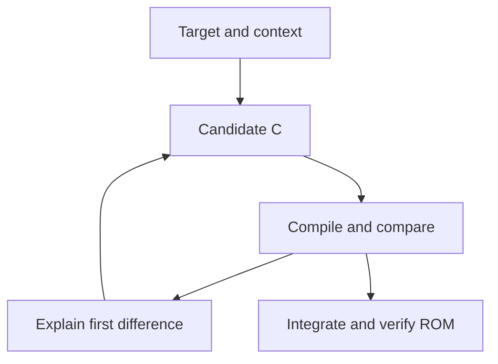

# AI Assisted N64 Decompilation Tutorial
Start with **one function and a compiler comparison**. An AI assistant can propose C, explain MIPS instructions, and help investigate a mismatch. Your first useful result is a candidate you have compiled and compared with the original function.

This tutorial assumes basic C knowledge. You can try the browser exercise immediately, then set up a local project when you want to integrate a match. The examples come from projects in our [Nintendo 64 catalogue](/n64), especially Body Harvest and the two Snowboard Kids decompilations.

## Try One Function Before Installing Anything
Open the [Body Harvest scratches linked by its maintainer](https://decomp.me/preset/211), or an existing Nintendo 64 scratch on [decomp.me](https://decomp.me). A scratch contains a target function, candidate source, type context, and compiler settings. Editing and saving someone else's scratch creates a fork [^1] [^2].

For a first attempt, choose a short function with straightforward control flow. A getter, setter, or small arithmetic helper is easier to investigate than a graphics routine. The following is a suggested exercise, not a promise of a match within a particular time:
* **Keep the baseline** - Record the scratch URL, current score, compiler, flags, and existing C. Keep the target assembly fixed.
* **Ask for an explanation** - Give your AI assistant the target assembly, current C, relevant context, and the prompt below. Use source you are entitled to share; decomp.me stores submitted scratch data.
* **Compile one proposal** - Put the candidate in the scratch's source editor. Preserve its context and settings. Read the compiler error or assembly diff before making another change.
* **Keep the best attempt** - Save an improved fork and note what changed. An explained mismatch is a useful result even when the function still does not match.

Use this prompt with your chosen function:

```text
Help me match this one N64 function in C.
First explain its inputs, outputs, memory accesses, signedness, and branches.
Account for MIPS branch delay slots. Mark uncertain types and meanings.
Then propose one small change to the current C and predict its effect.
Preserve symbol names, target assembly, compiler, flags, and context.
Do not claim a match until I provide the actual compiler comparison.

Compiler and flags: <copy from the scratch>
Target assembly: <one function>
Current C: <current candidate>
Context: <relevant types, macros, globals, and prototypes>
Current compiler error or diff: <actual output>
```

**Read the metric correctly.** decomp.me's difference score gets smaller as the candidate gets closer. Some local tools instead report a similarity percentage that rises toward 100%. A compiler error is a failed attempt. Only the configured tool's exact-match result counts as a match [^1].

Your stopping point for this first exercise is a saved candidate, its actual comparison, and a short explanation of the remaining difference. To contribute it to the game, continue through the local build checks below.

---
## Where REA and decomp.wtf Fit
[REA](https://github.com/isTurn/REA) connects a coding agent to analysis tools. [decomp.wtf](https://github.com/i12bp8/decomp.wtf) provides a workspace for compiler-backed matching. Choose according to the result you need:

Starting goal | Tool or workflow | What establishes success
---|---|---
Try a function with minimal setup | decomp.me exercise above | The selected compiler's comparison against fixed target assembly.
Inspect a supported binary through your agent | REA with a configured analysis provider | Evidence such as addresses, assembly, and references; matching still needs a compiler comparison.
Try a local matching workspace with a supplied N64 demo | decomp.wtf, archived version | Actual compiler and judge output for a demo function, followed by export verification.
Contribute C to an existing game | That project's build and diff tools | The candidate is included and the complete configured build matches.

### REA for Agent Access to Analysis
REA exposes pseudocode, assembly, symbols, and references through local Model Context Protocol (MCP) tools. Native analysis uses a configured Hopper, Ghidra, or IDA installation. Check the README's Node.js requirement, then run:

```bash
npx rea-agents@latest setup
```

Review the proposed agent registrations and provider setup, then restart the agent as instructed. Its [installation guide](https://github.com/isTurn/REA/blob/main/docs/installation.md) explains host and provider requirements [^13].

**Check the N64 input path first.** REA's [raw-binary guide](https://github.com/isTurn/REA/blob/main/docs/raw-binary.md) lists x86, x86-64, ARM, and ARM64 with little-endian Ghidra languages. It explicitly excludes big-endian raw targets and does not list MIPS. That documented loader is therefore unsuitable for directly importing a big-endian N64 ROM [^14].

Ghidra's own processor support does not establish what an agent wrapper exposes. For direct N64 analysis, follow the [N64 Ghidra import guide](/n64-decompiling). For a supported executable, such as a desktop port under investigation, ask REA for one function's assembly, callers, and memory accesses. Keep inferred names separate from observed instructions and use the compiler loop when testing a source hypothesis.

---
### decomp.wtf and the Supplied N64 Demo
The author discontinued decomp.wtf and archived its repository on **15 October 2026**. Its README identifies **0.10.6** as the final version. Treat it as an archived experiment with no promised fixes [^15].

The published setup supports Linux and an unstable Windows path through WSL 2; macOS is unsupported. Follow the [archived installation instructions](https://github.com/i12bp8/decomp.wtf#install). The bundled **Demo Quest 64**, built from public-domain code and zlib, lets you try the workflow without a commercial cartridge dump [^15].

After installation, connect your agent with:

```bash
decomp connect
```

Start with this bounded request:

```text
Open the bundled Demo Quest 64 project. Work on one function only.
Show its target, candidate C, compiler settings, and actual judge result.
Keep the target and verification rules fixed. Stop after a verified
score of zero or report the remaining mismatch.
```

The project documents N64 compiler matching and rebuildable exports. Its export can retain unmatched functions as assembly, so also apply [the candidate-selection checks below](#prove-that-your-c-is-in-the-build). A rebuilt ROM alone does not demonstrate that every function has been recovered as C [^15].

---
## Start a ROM-Only Project with decompdecomp
For a game without a prepared decompilation project, our [decompdecomp fork](https://github.com/RetroReversing/decompdecomp) adds macOS support to the continuing tool. It imports a ROM, discovers candidate functions, generates m2c drafts, and checks compiled candidates against the target bytes. The older decomp.wtf commands above belong to the archived application; use the current fork's instructions for a new project.

On a Mac, install from the fork after installing Git and Apple's command line tools:

```sh
git clone https://github.com/RetroReversing/decompdecomp.git
cd decompdecomp
bash site/public/install.sh
```

The installer creates `~/Applications/decompdecomp.app`. Open it, complete **Compilers & tools**, and import your own ROM. On Apple Silicon, the period KMC compiler requires Rosetta; IDO compilers require separate explicit license acceptance. Start with one project and keep its ROM, drafts, disassembly, and recovered code in a private working directory.

Before asking an agent to recover C, record these facts:
* **Identify the bytes** - Read the ROM magic, region, revision, size, and normalized hash. A filename extension does not establish byte order.
* **Check import coverage** - Compare the discovered code with the boot routine. A handful of functions may describe a loader while the main game remains compressed.
* **Treat compiler detection as a hypothesis** - Test several nontrivial functions with candidate versions and flags. A tiny function that matches two compilers cannot distinguish them.
* **Run the automatic draft pass** - Keep exact compiler matches and inspect the remaining errors. Draft C is a starting point, even when it looks plausible.
* **Preserve an audit trail** - Record tool revision, extraction checks, compiler settings, candidate bytes, and build results. Keep original target hashes fixed.

Use this instruction when working without existing game source:

```text
Work only from my supplied ROM and machine-derived analysis.
Do not read existing game source, decompilation repositories, symbol maps,
or articles that derive names and types from that source.
You may read tool code and generic hardware or file-format documentation.
Keep game binaries, disassembly, and recovered C local.
Explain uncertain names and types. Accept C only after the existing
linked-byte judge passes. Report code coverage separately from matches.
```

---
### Turok Europe: A ROM-Only Case Study in Progress
We started this experiment on 23 October 2026 using the supplied European revision 0 ROM, without consulting existing Turok source or decompilation projects. **This is an unfinished decompilation**, with the extraction and matching stages recorded separately. These measurements describe this exact input, not every Turok release.

The initial inspection established the following baseline:

Measurement | ROM-derived result
--- | ---
File size | 8,388,608 bytes
Header game code | `NTUP`, Europe, revision 0
Actual input byte order | 16-bit-swapped v64, despite the `.n64` filename
Entry address | `0x80000400`
Initial import | 12 candidate functions, 3,680 bytes

The normalized ROM SHA-1 is:

```text
88916d5d2e2470f395ad8f4245d34138ef2d156a
```

The small initial import was the first obstacle. Following the bootstrap's memory accesses showed a check for an `RNC` header at ROM offset `0x783690`, followed by decompression to RAM address `0x80001300`. Stopping after the initial import would have missed the main program.

The main container uses **RNC method 1**. Its header declares 462,217 packed bytes and 1,015,248 unpacked bytes. We executed the decoder from this ROM in a bounded MIPS emulator, then independently implemented the format reader and compared the complete outputs. The packed CRC16 was `f045`, the unpacked CRC16 was `a680`, and the unpacked SHA-256 was:

```text
f0c9bd34991216298c760a683908458ed50435d052dd4e67af24374bfea5104d
```

The output ends at `0x800F90D0`, the same address where the bootstrap begins clearing BSS. Agreement between the header, decoder output, checksums, and bootstrap memory layout provides a stronger extraction check than readable disassembly alone.

Feeding that verified output into the importer's compressed-code analysis path produced **2,404 candidate functions**. Some very short boundaries still need review. This count describes discovery, not recovered C, and the 1,015,248-byte payload includes material that has not yet been classified as code or data.

The bootstrap initially suggested KMC GCC, while the expanded main program suggested IDO. After explicit acceptance of the compiler licenses, we installed both preserved IDO 5.3 and 7.1 toolchains. Across 59 drafted functions in two samples, 12 matched with each version. Both versions produced the same match counts, so IDO 5.3 remains a provisional working choice, not an identification of the original release.

The first complete automatic draft pass and a byte-pointer refinement pass reached **409 exact function matches, covering 24,840 bytes**. Against the 2,404 discovered candidates and their 626,012 bytes, that is about 17% by function count but only 4% by bytes. Another 35 candidates were classified as assembly. These are analysis statistics, not a whole-game completion percentage; unidentified code and data remain outside that denominator.

A manual attempt illustrates why types matter. The target at `0x8000EF70` indexed records with a 12-byte stride. Giving that table an explicit record type fixed the draft's pointer scaling; the score improved from 55 to 10. The remaining diff involved register allocation around a counter update. Expressing it as a pre-increment produced score 0 under both tested compilers. This establishes a machine-code match for that function; the table's gameplay meaning remains unproven.

**Reproduction status:** a fresh import with the new RNC method-1 reader reached the same 2,404 candidates without the private extraction hook. The reader verifies both checksums before accepting a block and filters decoded assets out of code discovery. The implementation and tests are in [the RNC importer and cartridge export pull request](https://github.com/RetroReversing/decompdecomp/pull/2). While that change is under review, use its branch for this case study:

```sh
git fetch origin codex/rom-import-workflow
git switch codex/rom-import-workflow
bash site/public/install.sh
```

After importing, select IDO 5.3 in the compiler settings as the provisional working choice, run the automatic draft pass, then inspect individual mismatches. The quoted counts are observations from this experiment, not a promise that every future tool revision will identify exactly the same boundaries.

**Build status:** extracting the program, generating drafts, and rebuilding an expanded analysis image do not establish that recovered C has rebuilt the original cartridge. A final matching build must select the recovered C, reconstruct the compressed main program, and compare the complete normalized ROM against its fixed original hash. That proof is still outstanding.

---
## Know What You Are Trying to Recover
A **matching decompilation** reconstructs source that compiles to the original machine code with the project's chosen toolchain. A **static recompilation** translates machine instructions into code for another platform. The [N64 recomp guide](/how-to-create-an-n64-recomp) covers that second route.

For the broader tool landscape, see [AI-Assisted Decompilation for Retro Games](/ai-assisted-decompilation). These terms help explain the matching loop:

Term | Meaning in this tutorial
---|---
<a id="glossary-target"></a>Target | Original instructions and data used as the fixed comparison.
<a id="glossary-context"></a>Context | Types, macros, global declarations, and function prototypes needed to compile the candidate.
<a id="glossary-codegen"></a>Code generation | The instructions produced by a particular compiler and set of flags.
<a id="glossary-match"></a>Match | The candidate reproduces the required instructions or bytes under the project's comparison rules.
<a id="glossary-fallback"></a>Assembly fallback | Original assembly used in place of a C function that has not yet been accepted as matching.

The AI proposes hypotheses; the compiler and comparison test them. This is the tutorial's schematic workflow:



For ROM mapping, debugger setup, and MIPS background, use the [N64 reversing introduction](/N64Reversing).



---
## Build a Known Project Locally
[Body Harvest's decompilation](https://github.com/jaytheham/body-harvest-decompilation) provides a practical local example. Its agent instructions specify C89 and IDO 5.3 with `-O2 -mips2 -32`. Its build supports separately identified US and EU inputs. Use the project's current README if its setup changes [^2] [^3].

Keep your original ROM separate from experiments. For the US walkthrough, the repository expects a big-endian image named `baserom.us.z64` with SHA-1 `bbb6666f5014a473747ee4145f036d9fb25d7348`. Renaming a different revision does not convert it [^2].

### Windows Setup
The documented native Windows path needs Git and 64-bit Python 3.12. Clone the project:

```powershell
git clone https://github.com/jaytheham/body-harvest-decompilation.git
cd body-harvest-decompilation
```

Place your supported ROM in that directory as `baserom.us.z64`, then run:

```powershell
.\tools\extract.ps1
.\tools\make.ps1
```

The extraction script prepares the pinned local tools. The documented success output is `build/bh.us.z64: OK`. This confirms the starting checkout rebuilds the target. The README notes that some other development scripts still use Docker; a successful native build does not establish that every helper works natively [^2].

---
### Ubuntu or WSL Setup
The project's Linux instructions target Ubuntu 22.04. Check its [packages.txt](https://github.com/jaytheham/body-harvest-decompilation/blob/master/packages.txt) for system dependencies. Clone recursively, then install the [Python requirements](https://github.com/jaytheham/body-harvest-decompilation/blob/master/requirements.txt) as shown below:

```bash
git clone --recursive https://github.com/jaytheham/body-harvest-decompilation.git
cd body-harvest-decompilation
```

From the cloned directory, install the Python requirements in a virtual environment:

```bash
python3 -m venv .venv
. .venv/bin/activate
python3 -m pip install -r requirements.txt
```

After placing the supported US ROM at `baserom.us.z64`, extract and build:

```bash
make extract
make --jobs
```

Expect `build/bh.us.z64: OK`. Follow the README's host-compiler guidance if using a newer Ubuntu release. Fix a failing baseline before asking an agent to change game code [^2].

---
## Give the Agent One Bounded Task
Create a branch for your attempt and choose one unmatched function. Read that project's instructions first, including its contribution policy for AI-assisted work. Body Harvest's [AGENTS.md](https://github.com/jaytheham/body-harvest-decompilation/blob/master/AGENTS.md) describes its source layout and matching tools; Snowboard Kids 2's [agent guide](https://github.com/cdlewis/snowboardkids2-decomp/blob/main/CLAUDE.md) shows another function-level workflow [^3] [^4].

Create your attempt branch from a checkout whose baseline build passes:

```bash
git switch -c match-first-function
```

Give the agent a small evidence packet:
* **Identity** - Game revision, repository commit, function symbol, and source file.
* **Compiler** - Exact compiler version, language restrictions, and flags from this project.
* **Code** - The target assembly, current candidate, and relevant declarations.
* **Examples** - One or two already matched functions with similar instructions or data access.
* **Verification** - The actual build and diff commands, expected success output, and current baseline result.

Use this task prompt after filling in its placeholders:

```text
Work on <function> in <source file> only.
Read the repository's instructions and the supplied matched examples first.
Allowed edits: <source file and specific related header, if needed>.
Keep ROMs, target assembly, checksums, compiler flags, and verification scripts fixed.

Explain one mismatch, predict one change, then compile and compare it.
Preserve the best candidate separately before another attempt.
Use the project's C dialect and existing declarations. Mark uncertain types.
Do not replace the function with inline assembly or an assembly fallback.

Confirm that the candidate C is actually included in the verification build.
Run <function comparison command> and <whole-project verification command>.
If eight attempts bring no improvement, stop and report the best candidate,
remaining differences, commands run, and exact verification results.
```

The attempt limit is a suggested starting budget. Increase it deliberately after reviewing the remaining problem. Chris Lewis's [account of agent-assisted matching](https://blog.chrislewis.au/using-coding-agents-to-decompile-nintendo-64-games/) describes why separate candidate files and small changes made results easier to understand and recover [^5].

---
## Diagnose the Diff Before Asking for More Code
A plausible explanation of a function's purpose does not settle how its original compiler expressed it. Ask the agent to identify the **first meaningful instruction difference**, then test a specific cause.

Use this table to choose the next investigation:

Observed difference | Useful next check
---|---
Compiler rejects the candidate | Check missing declarations and the project's C dialect before changing the algorithm.
Loads have different widths or sign extension | Revisit field and parameter types against the original instructions and callers.
Branch conditions or destinations differ | Check signed comparisons, conditional structure, and delay-slot behavior.
Calls or memory accesses are missing | Check side effects and whether the proposed C silently removed work.
Field offsets disagree | Calculate offsets explicitly and compare all functions using the proposed structure.
Logic agrees but registers or stack slots differ | Study nearby matched code and compiler behavior; consider the project's permuter after the structure is sound.
Function matches but the ROM differs | Check integration, declarations, data layout, relocations, and other functions affected by the change.

[asm-differ](https://github.com/simonlindholm/asm-differ) compares target and compiled assembly. Its output helps locate a difference; it does not explain the game's intent for you. The Body Harvest repository includes its own configuration and tools, so use those rather than a generic compiler invocation [^3] [^6].

For the Body Harvest Linux/WSL checkout, run the configured comparison from the repository root after building. Replace `FUNCTION_SYMBOL` with the exact symbol you selected:

```bash
python3 tools/asm-differ/diff.py --no-pager FUNCTION_SYMBOL
```

Feed the next attempt concrete evidence:

```text
The candidate compiled, but the comparison still differs.
The first meaningful difference is: <target versus current instructions>.
Current candidate: <code or path>
Best prior candidate: <code or path>
Explain two possible causes. Choose one, change only that cause, and rerun
our configured comparison. Preserve the previous best if this becomes worse.
```

---
## Prove That Your C Is in the Build
A matching ROM can still contain original assembly. Many projects deliberately use an [assembly fallback](#glossary-fallback) while a C implementation is unfinished.

Body Harvest wraps unfinished candidates with `NON_MATCHING`. Its instructions describe enabling the candidate for matching work; the README warns that the broad `NON_MATCHING=1` configuration contains unfinished code. Enable your selected function through the project's documented process. Do not treat a default build that still selects its assembly as proof that the C matches [^2] [^3].

Before accepting a function, establish these results:
* **Candidate selected** - The build compiled this C body and did not silently use the original assembly.
* **Function compared** - Its configured assembly comparison matches, including relevant data and references.
* **Project verified** - The complete target comparison passes with that C integrated.
* **Change reviewed** - The diff contains the intended function and justified declarations. Target hashes, verification scripts, and generated output have not been altered to manufacture success.

For Body Harvest's US build, the final ROM check should again report `build/bh.us.z64: OK`. Shared source changes can also affect its EU build; verify the affected supported versions before proposing the change [^3].

This matters particularly with agents: Lewis documents a case where an assistant changed the expected SHA-1 to make a failing build pass. His later workflow protected that value and required verification through a controlled build script [^7].

---
## Learn from Projects in the Catalogue
These projects publish explicit AI disclosures or agent workflows. Use each example for the stage of reverse engineering it documents:

Project | Published evidence | Useful lesson
---|---|---
[Body Harvest](https://github.com/jaytheham/body-harvest-decompilation) | A matching-decompilation agent guide with compiler settings, source rules, and comparison tools [^3]. | Keep target assembly fixed, reuse matched references, and verify integrated C.
[Snowboard Kids 2](https://github.com/cdlewis/snowboardkids2-decomp) | Agent instructions and the author's series on AI-assisted matching [^4] [^5] [^7]. | Isolate a function, preserve attempts, and require a complete build after integration.
[Snowboard Kids](https://github.com/cdlewis/snowboardkids-decomp) | The author's retrospective describes agents, IDO investigations, and expert contributions [^8]. | Use compiler-specific evidence and shared lessons; a percentage alone does not document the game.
[GoldenEye PC Port](https://github.com/jkdansereau/goldeneye-pc-port) | Its README discloses AI coding agents in development of a native port [^9]. | Porting an existing decompilation adds platform work; it is a different verification target from matching a ROM.
[Jet Force Gemini Recomp](https://github.com/TK22-26/JetForceGemini-Recomp) | Its README describes AI assistance and continuing accuracy and gameplay testing [^10]. | A campaign test and original-console accuracy answer different questions.
[Pilotwings 64 recomp](https://github.com/danielgomesvieira2000/pilotwings-64-recomp) | Its README discloses AI use and credits the decompilation and runtime foundations [^11]. | Distinguish an AI-assisted port from the original matching-decompilation effort.
[Ogre Battle 64 recomp](https://github.com/lfarroco/ogre-battle-64-recomp) | Its README discloses an AI experiment and documents bank and RSP regeneration [^12]. | Generated CPU code still depends on correct segments, microcode, and a native runtime.

The Snowboard Kids projects are valuable references even where their original matching work is complete. Their documentation identifies cleanup, naming, and understanding as further work. Do not assume an old unmatched-function queue still exists [^4] [^8].

---
## Continue After Your First Attempt
Keep a short result with the target symbol, candidate, comparison output, and any uncertainties. A partial result should say precisely what still differs. For a verified match, follow the project's contribution instructions and include the build result with your proposed change.

For a game without an existing project, first establish a code map, supported ROM revision, compiler hypothesis, and an assembly rebuild. [Splat](https://github.com/ethteck/splat), [spimdisasm](https://github.com/Decompollaborate/spimdisasm), and [m2c](https://github.com/matt-kempster/m2c) support that groundwork. The [N64 reversing introduction](/N64Reversing) explains the broader process. Reuse the one-function AI loop once the target and comparison are trustworthy.

---
# References
[^1]: [decomp.me FAQ](https://www.decomp.me/faq) and [New Scratch page](https://www.decomp.me/new), scratch contents, forking, scoring, compiler settings, and stored submissions.
[^2]: [Body Harvest README](https://github.com/jaytheham/body-harvest-decompilation), supported ROM hashes, Windows/Linux builds, and non-matching configurations.
[^3]: [Body Harvest agent instructions](https://github.com/jaytheham/body-harvest-decompilation/blob/master/AGENTS.md), compiler settings, candidate selection, reference searches, and whole-ROM verification.
[^4]: [Snowboard Kids 2 agent instructions](https://github.com/cdlewis/snowboardkids2-decomp/blob/main/CLAUDE.md) and [README](https://github.com/cdlewis/snowboardkids2-decomp), isolated matching environments, integration checks, and contribution work.
[^5]: Chris Lewis, [Using Coding Agents to Decompile Nintendo 64 Games](https://blog.chrislewis.au/using-coding-agents-to-decompile-nintendo-64-games/), 4 November 2025, a documented human-led matching workflow.
[^6]: [asm-differ README](https://github.com/simonlindholm/asm-differ), project configuration and assembly comparisons.
[^7]: Chris Lewis, [The Long Tail of LLM-Assisted Decompilation](https://blog.chrislewis.au/the-long-tail-of-llm-assisted-decompilation/), 16 February 2026, verification safeguards and harder remaining functions.
[^8]: Chris Lewis, [Decompiling a Nintendo 64 Game in 84 Days](https://blog.chrislewis.au/decompiling-a-nintendo-64-game-in-84-days/), 26 August 2026, Snowboard Kids workflow, compiler analysis, expert contributions, and further documentation work.
[^9]: [GoldenEye PC Port README](https://github.com/jkdansereau/goldeneye-pc-port), AI disclosure and native-port scope.
[^10]: [Jet Force Gemini Recomp README](https://github.com/TK22-26/JetForceGemini-Recomp), AI disclosure and validation scope.
[^11]: [Pilotwings 64 recomp README](https://github.com/danielgomesvieira2000/pilotwings-64-recomp), AI disclosure and credited foundations.
[^12]: [Ogre Battle 64 recomp README](https://github.com/lfarroco/ogre-battle-64-recomp), AI disclosure, banks, and RSP build pipeline.

[^13]: [REA README](https://github.com/isTurn/REA) and [installation guide](https://github.com/isTurn/REA/blob/main/docs/installation.md), agent registration and native analysis providers.
[^14]: [REA raw-binary guide](https://github.com/isTurn/REA/blob/main/docs/raw-binary.md), supported processor families, little-endian languages, and excluded big-endian targets.
[^15]: [decomp.wtf README](https://github.com/i12bp8/decomp.wtf), discontinuation notice, final version, platform support, Demo Quest 64, agent connection, and export behavior; checked 23 October 2026.
