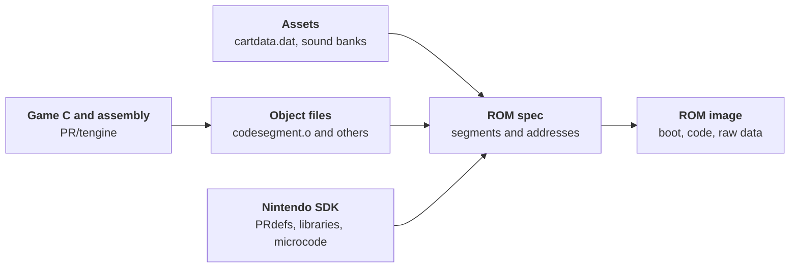

# Turok Dinosaur Hunter from cartridge to code
<section class="rr-game-media-row">
  <figure class="rr-game-figure">
    
    <figcaption>Turok: Dinosaur Hunter box art for the North American Nintendo 64 release. Image from the RetroReversing archive.</figcaption>
  </figure>
  <div class="rr-game-media-row__copy" markdown="1">
<p class="rr-game-intro__kicker">Nintendo 64 / 1997 / Iguana Entertainment</p>

**The game.** *Turok: Dinosaur Hunter* is a first-person shooter developed by Iguana and published by Acclaim [^11] [^3]. The comic-book hero crosses the Lost Land, fighting dinosaurs and other enemies while recovering pieces of the Chronoscepter [^12].

**The makers.** A retrospective with Iguana staff describes a core development team of 18 [^10]. The N64 credits name **Rob Cohen** as lead programmer, **Nigel Cook** as Iguana's creative director, and **Alan D. Johnson** as lead artist. GameFAQs lists **62 numbered credit entries** across specialties, including Acclaim roles and repeated names; that total is not a headcount of Iguana's core team [^3].

**The leak.** In 2017, a preservationist found Turok source code on former Acclaim **SGI Indy workstations** [^15]. He said their previous owner had acquired them at Acclaim's 2004 bankruptcy auction [^15]. A leaked copy surfaced in public discussion in 2018 [^1]. The files do not establish their exact route from those machines into circulation.

**Why it matters.** The original RetroReversing article identified Turok as the **first commercial Nintendo 64 game whose original source code became public** [^13]. The ROM layout, bootstrap loader, asset index, cheats, and Controller Pak code show how cartridge data becomes a running world.
  </div>
</section>

<aside class="rr-source-path" aria-label="Reading source paths" markdown="1">
<p class="rr-source-path__eyebrow">Reading the source paths</p>
<div class="rr-source-path__segments" aria-label="src slash PR slash tengine slash spec">
  <div class="rr-source-path__segment"><code>src</code><span>Supplied archive</span></div>
  <div class="rr-source-path__segment"><code>PR</code><span>Project Reality SDK tree</span></div>
  <div class="rr-source-path__segment"><code>tengine</code><span>Turok game project</span></div>
  <div class="rr-source-path__segment"><code>spec</code><span>ROM layout file</span></div>
</div>

`PR` carries the **Project Reality** codename [^13]. Nintendo's SDK used `/usr/src/PR` for sample programs and `/usr/include/PR` for headers [^14]. Turok's `tengine` directory sits beside those samples. Paths in this article start at the supplied archive's `src` directory, outside this website's repository.
</aside>

---
## The cartridge and what is inside
<section class="rr-game-media-row">
  <figure class="rr-game-figure">
    
    <figcaption>North American Turok cartridge. Image from the RetroReversing archive.</figcaption>
  </figure>
  <div class="rr-game-media-row__copy" markdown="1">
The North American cartridge presents the same game art seen on the box. This is the retail medium that the ROM layout in `PR/tengine/spec` targets.

An opened Nintendo 64 cartridge helps locate the ROM chip and edge connector physically. The board below is a **representative NUS-01A-01 board**, not an identified Turok board; it should not be used to infer the components or capacity of this particular copy.
  </div>
</section>

<figure class="rr-game-figure">
  
  <figcaption>Inside a representative Nintendo 64 cartridge. Board identity is visible; its association with Turok has not been established. Image from the RetroReversing archive.</figcaption>
</figure>

The source tree also contains `PR/tengine/rom.rnc`, an 8 MiB file. Its size alone does not prove that it matches every retail cartridge revision. The more useful evidence for this analysis is `spec`, which states which segments a build places in a ROM.

---
# Development environment
The archive mixes production game files with Nintendo's `PR` SDK tree. Keeping those layers separate makes it easier to see which technology Iguana used and which files are sample programs or library support.

## Nintendo 64 SDK and ROM layout
`PR/tengine/Makefile` includes `$(ROOT)/usr/include/make/PRdefs`. The adjacent `spec` file defines boot code, audio and display-list memory, frame buffers, a cartridge cache, a Z-buffer, raw data segments, and the main code segment. It also names Nintendo microcode objects such as `gspF3DEX.NoN.fifo.o`.



The diagram is a reading map for the files, not proof that the supplied archive builds without changes. The `Makefile` contains commented final-build commands, and this article does not claim a reproducible retail build.

## Workstations and authoring tools
The source confirms a mixed environment. `PR/tengine/cart.c` has a `WIN32` branch for host-side code, while the N64 build uses Nintendo SDK headers and tools. References to Windows paths or preprocessor flags demonstrate code paths, not which computer every developer used. Accounts of SGI workstations at Iguana provide additional historical context [^2] [^9].

For 3D authoring, `PR/tengine/tengine.h` declares `mf_3dstudio_to_u64`, a matrix named for converting 3D Studio coordinates to Ultra 64 coordinates. That is concrete evidence of a 3D Studio import path. It does not, by itself, identify the exact software version used by every artist. Interviews with the team provide further context [^10].

The game also used Rob Northen's ProPack compression. `PR/tengine/cart.c` calls `PackRNC`, while the bootstrap in `boot.c` checks for an RNC header and dispatches to method 1 or 2 decompression. The archive includes unpacking code in `unpack.c` and `rnc2.s` [^6].

A documentary about **Turok 3** shows later Acclaim development equipment, including a Doctor V64 and Windows tools [^7] [^8]. That footage illustrates the studio's later workflow; it does not establish that those exact devices were used for the first Turok.

---
# Find the game in the archive
The `src/PR` directory contains many SDK examples, including `simple`, `gtdemo`, and `spgame`. The game-specific material is under `src/PR/tengine`. Its `dosvers` directory contains a separate host-side source variant; compiled objects and generated files also appear beside the C and assembly sources.


Start in `tengine` when tracing the game. Follow `spec` for the ROM layout and `cartdir.h` for the asset index. Treat neighboring SDK demo directories as context, not as Turok engine modules.


- boot.c - loads the main code segment and handles an RNC header
- spec - defines ROM segments and memory placement
- cart.c, cart.h, cartdir.h - indexed asset storage, compression, and block names
- ai.c, aidoor.c, aistand.c - enemy behavior and AI support
- scene.c, romstruc.c - world data and runtime structures
- cheats.c, control.c - cheat menu, input, and Controller Pak support
- dosvers/ - host-side source and tools



The tree highlights entry points for investigation, not an exhaustive inventory. For example, `PR/tengine/cartdata.dat` is only 7,576 bytes in this copy, whereas `PR/cartdata.dat` is 6,489,336 bytes and `PR/tengine/oldcartdata.dat` is 6,451,432 bytes. These are distinct files. Use the path and byte size when reporting findings, rather than referring to an unspecified `cartdata.dat`.

---
# How the game data is packed
`PR/tengine/cartdir.h` names eleven root blocks in the asset container. `cart.h` defines a `CIndexedSet`: a big-endian block count followed by offsets. `cart.c` uses adjacent offsets to calculate each stored block's byte length. The first block begins after the aligned index header.

The root blocks in the 6,489,336-byte `PR/cartdata.dat` file are summarized here. These are **stored sizes**; compressed content may expand at runtime.

Block | Content named in cartdir.h | Stored bytes
---|---|---:
0 | Graphic objects | 2,380,400
1 | Object attributes | 9,504
2 | Object types | 1,360
3 | Texture sets | 1,900,192
4 | Particle effects | 11,720
5 | Sound effects | 9,824
6 | Levels | 2,110,736
7 | Persistent counts | 448
8 | Warp destinations | 5,024
9 | Binaries | 60,008
10 | Binary types | 64

Graphic objects, texture sets, and levels account for most stored bytes in this copy. The names tell us how the root directory is organized; they do not imply that every original authoring file or editable 3D Studio scene is present.

## Explore the index yourself
The viewer starts with the real root offsets from `PR/cartdata.dat`. Select a local copy of a root `cartdata.dat` to inspect its eleven block sizes. It reads only the header in your browser; it does not upload the file or decompress assets.

<div class="rr-turok-index" data-rr-turok-index>
  <div class="rr-turok-index__controls">
    <label for="rr-turok-index-file">Choose a local cartdata.dat file</label>
    <input id="rr-turok-index-file" type="file" accept=".dat">
    <button type="button" data-rr-turok-reset>Restore sample</button>
  </div>
  <p data-rr-turok-status aria-live="polite">The sample shows eleven root blocks from PR/cartdata.dat.</p>
  <div data-rr-turok-rows></div>
</div>
<script defer src="/public/js/turok-cart-index.js"></script>

A quick manual check is to read the first four bytes of `PR/cartdata.dat`: `00 00 00 0B` is eleven in big-endian order. The next word, `00 00 00 38`, places the first block at offset 56. `cartdir.h` maps block zero to graphic objects. This is a useful starting point before trying to parse the nested sets.

## From ROM to running code
`PR/tengine/spec` names the nearby `tengine/cartdata.dat` in a raw `static` segment. That 7,576-byte file is distinct from the much larger `PR/cartdata.dat` explored above; the spec alone does not show how the larger file would enter this build. `boot.c` separately loads the main code segment from ROM. It first reads twelve bytes and checks for the ASCII `RNC` signature. If present, it reads the compressed length, transfers the compressed block, then calls the method 1 or method 2 unpacker. Otherwise it copies the code segment directly. It then clears caches and BSS before calling `boot()`.

```c
// PR/tengine/boot.c: the decision at the start of BootEntry
DecompFlag = ((_codeSegmentStart[0] == 'R') &&
              (_codeSegmentStart[1] == 'N') &&
              (_codeSegmentStart[2] == 'C'));
```

This distinction matters: the bootstrap's RNC check is for the **code segment**, while `cart.c` also supports compression of individual asset blocks. An RNC header in one place does not mean the entire `cartdata.dat` file is a single RNC stream.

---
# Game systems visible in the source
The archive is more than a ROM packaging exercise. Its game modules expose systems that can be followed from input through state changes to rendering and saving.

## Cheats and menu drawing
`PR/tengine/cheats.c` contains the menu state, selection logic, cheat flag toggles, and draw calls. In `CCheat__Draw`, the game draws a translucent box, places a highlight bar using `m_RealSelection`, and renders the enabled option text. `CCheat__Update` handles moving the selection and toggling flags such as invincibility and unlimited ammo.

<figure class="rr-game-figure">
  
  <figcaption>The cheat menu as shown by <a href="https://tcrf.net/Turok:_Dinosaur_Hunter_(Nintendo_64)">The Cutting Room Floor</a>; the menu implementation is in <code>cheats.c</code>.</figcaption>
</figure>

For a focused reading exercise, find `CCheat__Update` and follow one flag into `CCheat__Draw` and the game system that consumes it. The source distinguishes flags that are enabled for display from flags that are active in play.

## Controller Pak saves
`PR/tengine/control.c` holds `OSPfs ControllerPak`, directory state, and the game's Controller Pak identifiers. Its `GameCode` is `NTUE` and its `CompanyCode` is `51`. The `GameName` array in this copy uses encoded byte values, rather than the plain ASCII `turok` array left in a comment. The save payload is modeled by `CPersistantData` in `tengine.h`, including inventory, level keys, settings, health, and cheat flags.

<figure class="rr-game-figure">
  
  <figcaption>Nintendo 64 Controller Pak, used for Turok save files. Image from the RetroReversing archive.</figcaption>
</figure>

A saved `.mpk` file from an emulator can be inspected with a hex editor or a [Controller Pak editor](https://rawgit.com/bryc/mempak/master/index.html). Compare the directory entry and game code before interpreting the payload. The C structure alone is not a complete on-disk format specification.

## Models, worlds, and related games
The 3D Studio conversion matrix in `tengine.h` connects the game runtime to its art pipeline. `scene.c`, `romstruc.c`, and `cartdir.h` provide better starting points for tracing geometry, collision, and level data than the generic SDK demo folders.

Iguana also built a world editor, according to a contemporary interview [^4]. The editor's original project files are not demonstrated by the source paths examined here. The later Turok remaster has an editor, but the relationship between that editor and Iguana's original tool is not established by this archive [^5].

The first South Park Nintendo 64 game is reported to have used technology from Turok [^9]. That is useful context for the engine's later life, not a reason to assume every file in this Turok archive shipped in South Park.

---
# Reproducing the investigation
The paths in this page are enough to repeat the main checks without running an old SDK. Begin with `PR/tengine/spec` to identify segments, then `boot.c` for code loading. Read `cart.h` and `cartdir.h` before inspecting `PR/cartdata.dat`; the root index is big-endian and contains offsets rather than file names. Use `cheats.c` and `control.c` for two small, self-contained game systems.

The archive includes generated objects and a ROM image, but a clean rebuild depends on an appropriate historical toolchain and inputs. The earlier build notes below record obstacles encountered with one setup. They are observations, not verified fixes for every environment.

<details>
<summary>Historical build notes from the earlier version of this article</summary>

One attempt used a replacement `stddef.h` and changed its `NULL` definition after a `trex.c` compile error. Another encountered an assembler operand error in `adpcm.s` and continued with the existing `adpcm.o`. A linker or assembler warning reported that `osWritebackDCacheAll` and `osInvalICache` changed symbol type in `codesegment.o`. These workarounds can affect the resulting binary and should be checked against the exact SDK and compiler in use.

</details>

---
# Video companions
The original article also featured a source discovery video titled "Turok 64 Official Source Code Found". Its creator and current availability could not be verified from the supplied archive, but the original YouTube embed is preserved here for readers who can access it.

<iframe width="560" height="315" src="https://www.youtube.com/embed/ONEy_ybKWsg" title="Turok 64 Official Source Code Found" loading="lazy" allow="accelerometer; autoplay; clipboard-write; encrypted-media; gyroscope; picture-in-picture; web-share" allowfullscreen></iframe>

The article also featured [The Making of Turok Dinosaur Hunter for Nintendo 64](https://www.twitch.tv/videos/125480737) as a Twitch recording. The link retains that reference even where Twitch embedding is unavailable.

---
# References
[^1]: [Turok Forums discussion of the source archive](https://www.turokforums.com/index.php?topic=645.0)
[^2]: [Community discussion of the discovered source code](https://www.reddit.com/r/gamedev/comments/5nxqi9/n64_turok_dinosaur_hunter_source_code_discovered/)
[^3]: [Turok credits at GameFAQs](https://gamefaqs.gamespot.com/n64/199130-turok-dinosaur-hunter/credit)
[^4]: [IGN interview with the creator of Turok](https://www.ign.com/articles/1997/01/16/interview-with-the-creator-of-turok)
[^5]: [Turok remaster on Steam](https://store.steampowered.com/app/405820/Turok/)
[^6]: [Rob Northen Compression technical notes](https://wiki.multimedia.cx/index.php/RNC_ProPack)
[^7]: [Archived Turok 3 development equipment discussion](https://web.archive.org/web/20001119222300/http://www.dextrose.com:80/info/0428turok3dev.htm)
[^8]: [Video Games: Creating Virtual Fantasy documentary excerpt](https://youtu.be/dJXHyXxM0fg?t=1659)
[^9]: [The making of Turok Dinosaur Hunter](https://www.gamesradar.com/uk/the-making-of-turok-dinosaur-hunter/)
[^10]: [Nintendo Life interview on making Turok](http://www.nintendolife.com/news/2016/05/feature_the_making_of_turok_dinosaur_hunter)
[^11]: [Turok: Dinosaur Hunter release and credits at MobyGames](https://www.mobygames.com/game/2203/turok-dinosaur-hunter/)
[^12]: [Turok game description on Steam](https://store.steampowered.com/app/405820/Turok/)
[^13]: [Original RetroReversing Turok source code article](https://frds.github.io/turok64sourcecode)
[^14]: [Nintendo 64 SDK OS 2.0J release notes](https://ultra64.ca/files/documentation/online-manuals/man/n64man/relnote_j/index.htm)
[^15]: [2017 report on Turok source code found on former Acclaim workstations](https://www.gamedeveloper.com/game-platforms/source-code-for-i-turok-i-and-i-nba-jam-extreme-i-surfaces)
