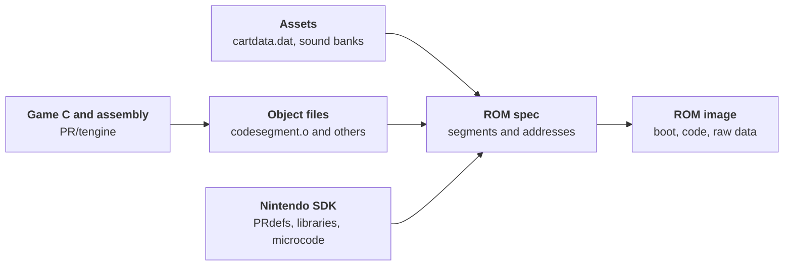

<link rel="stylesheet" href="/public/css/game-data-visual.css">
<script defer src="/public/js/game-data-visual.js"></script>

# Turok Dinosaur Hunter from cartridge to code
<section class="rr-game-media-row">
  <figure class="rr-game-figure">
    
    <figcaption>Turok: Dinosaur Hunter box art for the North American Nintendo 64 release.</figcaption>
  </figure>
  <div class="rr-game-media-row__copy" markdown="1">
<p class="rr-game-intro__kicker">Nintendo 64 / 1997 / Iguana Entertainment</p>

**The game.** *Turok: Dinosaur Hunter* is a first-person shooter developed by Iguana and published by Acclaim. It released for Nintendo 64 in North America on **4 March 1997** [^11] [^16]. The comic-book hero crosses the Lost Land, fighting dinosaurs and other enemies while recovering pieces of the Chronoscepter [^12].

**The makers.** Producer David Dienstbier recalled a final game team of **about 17 or 18 people** [^19]. The N64 credits name **Rob Cohen** as lead programmer, **Nigel Cook** as Iguana's creative director, and **Alan D. Johnson** as lead artist. Another account gives **nine programmers, 22 artists, and more than 61 contributors**, but does not explain how it counted the team [^13]. GameFAQs lists **62 numbered credit entries** across specialties, including Acclaim roles and repeated names; those entries are not a headcount of Iguana's core team [^3].

**The leak.** In 2017, a preservationist found Turok source code on former Acclaim **SGI Indy workstations** [^15]. He said their previous owner had acquired them at Acclaim's 2004 bankruptcy auction [^15]. A leaked copy surfaced in public discussion in 2018 [^1]. The files do not establish their exact route from those machines into circulation.

**Why it matters.** *Turok* has been identified as the **first commercial Nintendo 64 game whose original source code became public** [^13]. The ROM layout, bootstrap loader, asset index, cheats, and Controller Pak code show how cartridge data becomes a running world.

**What survives.** The top level of `PR/tengine` in this copy contains **78 `.c` files, four `.s` files, and one `.cpp` file**. The source is predominantly C, with assembly for selected low-level routines.
  </div>
</section>

<aside class="rr-source-path" aria-label="Reading source paths" markdown="1">
<p class="rr-source-path__eyebrow">Reading the source paths</p>
<div class="rr-source-path__segments" aria-label="src slash PR slash tengine slash spec">
  <div class="rr-source-path__segment"><code>src</code><span>Supplied archive</span></div>
  <div class="rr-source-path__segment"><code>PR</code><span>Project Reality SDK tree</span></div>
  <div class="rr-source-path__segment"><code>tengine</code><span>Turok game project</span></div>
  <div class="rr-source-path__segment"><code>spec</code><span>ROM layout file</span></div>
</div>

`PR` carries the **Project Reality** codename [^13]. Nintendo's SDK used `/usr/src/PR` for sample programs and `/usr/include/PR` for headers [^14]. Turok's `tengine` directory sits beside those samples. File paths on this page begin at the archived `src` folder.
</aside>

---
## The cartridge and what is inside
<section class="rr-game-media-row">
  <figure class="rr-game-figure">
    
    <figcaption>North American Turok cartridge.</figcaption>
  </figure>
  <div class="rr-game-media-row__copy" markdown="1">
The North American cartridge presents the same game art seen on the box. Inside is the game's ROM: the read-only program and data the console loads. A surviving development file called `spec` shows how its pieces were meant to be arranged.

An opened Nintendo 64 cartridge helps locate the ROM chip and edge connector physically. The board below is a **representative NUS-01A-01 board**, not an identified Turok board; it should not be used to infer the components or capacity of this particular copy.
  </div>
</section>

<figure class="rr-game-figure">
  
  <figcaption>Inside a representative Nintendo 64 cartridge. Board identity is visible; its association with Turok has not been established.</figcaption>
</figure>

The retail game was distributed on a **64 Mbit (8 MiB) cartridge** [^17]. The surviving files include `PR/tengine/rom.rnc`, a ROM image just shy of that size. Despite the `.rnc` name, the file begins with a Nintendo 64 ROM header: it is a cartridge image, not one compressed archive.

The `rom.rnc` image is a surviving result; `PR/tengine/spec` is the build plan. The plain-text `spec` lists the pieces to put into a ROM, from boot and game code to sound and other data, and gives key memory locations. Some pieces were compressed to make the most of the cartridge's limited space. These files show how Iguana planned the ROM, though they do not establish whether this particular image matches a retail release byte for byte.

---
# Development environment
The archive mixes Iguana's game files with Nintendo's `PR` SDK tree. The game files show how Turok worked; the neighboring SDK samples and libraries show the tools available to its programmers.

## Nintendo 64 SDK and ROM layout
`PR/tengine/Makefile` includes `$(ROOT)/usr/include/make/PRdefs` from [Nintendo's official N64 SDK](/n64-sdk). The adjacent `spec` file defines boot code, audio and display-list memory, frame buffers, a cartridge cache, a Z-buffer, raw data segments, and the main code segment. It also names Nintendo microcode objects such as `gspF3DEX.NoN.fifo.o`.



The diagram traces the roles of these files. The `Makefile` contains commented final-build commands, so the archive does not establish that the retail game can be rebuilt without changes.

## Workstations and authoring tools
Iguana combined **SGI test hardware**, an **in-house world editor**, 3D modeling and motion capture, and a separate music workflow. The hardware photo and software screens below are representative; only the documentary frame shows Acclaim's own workspace.

### SGI stations and the changing development kit
<section class="rr-game-media-row">
  <figure class="rr-game-figure">
    
    <figcaption>A representative Ultra 64 development board inside an SGI Indy. This photographed unit is not identified as Iguana hardware.</figcaption>
  </figure>
  <div class="rr-game-media-row__copy" markdown="1">
**Two shared stations.** David Dienstbier described one SGI workstation in a common room where artists could test assets in the engine, and another in the lead programmer's office [^9] [^13]. The source discovery also involved former Acclaim **SGI Indy** machines [^15].

**A console on a board.** The [SGI-based Nintendo 64 development kit](/official-n64-devkit) used a GIO expansion card inside the Indy, as Nintendo's hardware documentation describes [^29]. It allowed testing on N64 hardware without writing a cartridge for every change. Creative director Nigel Cook recalled receiving final development kits about halfway through production, with little rework despite earlier hardware uncertainty [^10].
  </div>
</section>

The SDK release notes in `PR/relnotes` discuss **IRIX 5.3 and 6.2**. An `src/X11` folder exists, but does not identify the desktop the team used. The `PR/man/F3DEX/README` date of **15 October 1996** belongs to F3DEX microcode release 1.00, not the entire SDK. The game files use Nintendo headers, libraries, and microcode; no separate third-party SDK has been identified in those files.

---
### World building and character animation
<section class="rr-game-media-row">
  <figure class="rr-game-figure">
    
    <figcaption>3D Studio Release 4 illustrates the period's modeling software. This is not a screenshot of Iguana's project.</figcaption>
  </figure>
  <div class="rr-game-media-row__copy" markdown="1">
**Iguana's own editor.** Dienstbier said the team built its world editor and animation handling internally [^4]. Cook recalled building the editor while Nintendo 64 hardware was still being finalized [^10]. The editor's project and executable have not been identified in this supplied archive.

**Two kinds of movement.** Animator Greg Omelchuck said the human animation was motion captured, while the dinosaurs were animated by hand in 3D Studio, with their legs adjusted frame by frame [^10]. Acclaim's motion-capture team described filming stunt performer Brad Martin as he was pulled and thrown to simulate attacks [^19].

**A source-code clue.** `PR/tengine/tengine.h` declares `CMtxF mf_3dstudio_to_u64`, a coordinate-conversion matrix. `cartdir.h` indexes geometry and animation data. Together they show the path into game-ready assets, though the editable 3D scene projects are not present here.
  </div>
</section>

Omelchuck recalled the software as "3D Studio Max v4" [^10]. Autodesk's records put **3D Studio Release 4** in 1994, **3D Studio MAX** on sale by January 1997, and **3ds max 4** in use by January 2001 [^21] [^22] [^23]. That last version postdates Turok's launch, so the exact version behind the recollection remains uncertain. The wider range of [N64 3D modeling software](/n64-3d-modelling) gives this tool choice context.

---
### Music, samples, and compression
<section class="rr-game-media-row">
  <figure class="rr-game-figure">
    
    <figcaption>RNC ProPack packing software; Turok's source contains a matching `PackRNC` call and unpackers.</figcaption>
  </figure>
  <div class="rr-game-media-row__copy" markdown="1">
**Composer's tools.** Darren Mitchell said he used sounds from **Ensoniq ASR-10 and TS-12** instruments for the first two Turok games. He sequenced in **Performer**, then used proprietary tools to get the music running on Nintendo 64 [^30].

<div class="rr-tool-steps" role="list" aria-label="Music workflow described by Darren Mitchell">
  <div role="listitem"><strong>Ensoniq</strong><span>ASR-10 and TS-12 sounds</span></div>
  <div role="listitem"><strong>Performer</strong><span>Music sequencing</span></div>
  <div role="listitem"><strong>Proprietary tools</strong><span>Nintendo 64 implementation</span></div>
</div>

Mitchell said the producer described each level's creatures and atmosphere before he composed, followed by revisions together [^30].

**Cartridge packing.** `PR/tengine/cart.c` calls `PackRNC`; `boot.c` checks for an RNC code-segment header and dispatches to method 1 or 2 decompression. The archive includes `unpack.c` and `rnc2.s`. [Sega Retro's RNC overview](https://segaretro.org/Rob_Northen_compression) explains the format.
  </div>
</section>

**Two audio banks.** The ROM build plan places music and sound effects in separate [N64 sound-bank](/n64sound#n64-sound-banks) pairs. A `.ctl` file describes instruments and sounds; its matching `.tbl` holds the sample bytes that the audio engine plays. In `audio.c`, `alBnkfNew` connects each control bank to its sample table.

The loose audio files contain these banks:

Use | Control file | Sample table
---|---|---
Music | `testbank.ctl` - 5,504 bytes, 24 instrument entries | `testbank.tbl` - 257,752 bytes
Sound effects | `sfx.ctl` - 127,688 bytes, one instrument with 624 sound entries | `sfx.tbl` - 7,298,152 bytes

The 624 entries are mappings inside the sound-effects bank, not a verified count of distinct recorded samples. The surviving ROM image contains the `testbank` pair byte for byte, but its sound-effects control bank has **228 sound entries** and differs from the loose `sfx.ctl`. The loose `sfx.tbl` does not appear byte for byte in that ROM image either.

The working directory also holds **5,034 individual sound files** under `PR/tengine/sounds`: 4,406 `.aif` sources and 628 `.n64` files whose headers identify Nintendo 64 VADPCM audio. The chart counts files, not unique sounds or the contents of a retail bank. Most run for one to two seconds - a glimpse of the many short effects behind the Lost Land.



The header of `PR/tengine/rnc.s` calls itself **"PROPACK Unpack Source Code - Sony PSX, Method 2"** and records a conversion to SGI assembler on **13 September 1996**. It documents the unpacker's code lineage, not a PlayStation build of Turok. In `boot.c`, the `RNC` signature check applies to the loaded code segment; `cart.c` handles individual asset blocks separately.

---
### What later Acclaim footage shows
<section class="rr-game-media-row">
  <figure class="rr-game-figure">
    
    <figcaption>A Doctor V64 in Turok 3 development footage. This frame does not establish its use on the first game [^8].</figcaption>
  </figure>
  <div class="rr-game-media-row__copy" markdown="1">
A documentary about **Turok 3** shows a [Bung Doctor V64](/official-n64-devkit#bung-doctorv64) and Windows development tools [^7] [^8]. A 1997 report priced the V64 at **US$450** [^24]. The footage establishes later Acclaim use, but not whether Iguana had one for the first Turok.

The same documentary shows an Acclaim **ArtSend debugging cartridge** around the seven-minute mark [^25]. That shot features the ArtSend, a different device from the V64. `PR/tengine/cart.c` also has a `WIN32` branch for host-side code, but that does not identify the IDE used for the original N64 game. A Windows edition, ported by Sculptured Software, has a **26 November 1997 US release** in GameFAQs and MobyGames [^18] [^20].
  </div>
</section>

---
# Find the game in the archive
The `src/PR` directory contains many SDK examples, including `simple`, `gtdemo`, and `spgame`. The game-specific material is under `src/PR/tengine`. Its `dosvers` directory contains a separate host-side source variant; compiled objects and generated files also appear beside the C and assembly sources.


The game-specific trail begins in `tengine`. Its `spec` file maps the ROM layout, while `cartdir.h` names the asset blocks. The neighboring SDK demo directories are separate from the Turok engine.


- boot.c - loads the main code segment and handles an RNC header
- spec - defines ROM segments and memory placement
- cart.c, cart.h, cartdir.h - indexed asset storage, compression, and block names
- ai.c, aidoor.c, aistand.c - enemy behavior and AI support
- scene.c, romstruc.c - world data and runtime structures
- cheats.c, control.c - cheat menu, input, and Controller Pak support
- dosvers/ - host-side source and tools



## Browse the archive as a desktop
This **SGI desktop-inspired simulation** lets you explore the names and folders in this copy of the Turok archive. Start in `PR/tengine`, where the game code sits, or jump to the Nintendo SDK samples and the neighboring workstation software. Select a file to see its size and a short account of its purpose. The index covers **10,478 files in 160 folders**, but contains no file contents.



The source copy gives every file an **October 2026** filesystem date, matching when this copy was made. Those dates do not identify when Iguana wrote the files, so the explorer omits them.

## Four versions of the asset directory
The three loose `cartdata` files and the ROM image each contain an eleven-block directory. `cartdir.h` names those blocks: graphic objects, textures, levels, sound-effect definitions, and other game data. Their matching structure hides different contents. These are counts of indexed entries, not counts of playable maps or original art projects:

Asset directory | Stored bytes | Graphic entries | Texture-set entries | Level entries | Binary entries
---|---:|---:|---:|---:|---:
`PR/tengine/cartdata.dat` | 7,576 | 1 | 0 | 1 | 5
`PR/cartdata.dat` | 6,489,336 | 674 | 1,035 | 50 | 14
`PR/tengine/oldcartdata.dat` | 6,451,432 | 674 | 1,033 | 51 | 30
Inside `PR/tengine/rom.rnc` | 6,502,520 | 674 | 1,033 | 50 | 30

The tiny file named by `spec` has only one graphic entry, no texture sets, and one level entry. The large `PR/cartdata.dat` has hundreds of graphic and texture entries; it is the file explored in the next section. `oldcartdata.dat` is another substantial version, but its name alone does not date it. The ROM image contains a fourth version, beginning at byte **7,936 (`0x1F00`)**, which matches none of the loose files byte for byte.

The large `PR/cartdata.dat` and loose `sfx.tbl` together occupy about **13.1 MiB**, before code or music. Both could not simply be copied in full into an **8 MiB** cartridge. The surviving files represent different asset and audio versions rather than one complete, matching set for a retail build.

The game Makefile includes Nintendo's `PRdefs`, and the archive contains SDK demos beside `tengine`. No matching demo or copied-file history has been identified, so these clues show SDK integration rather than which template, if any, Iguana started from.

---
# How the game data is packed
`PR/tengine/cartdir.h` names eleven root blocks in the asset container. `cart.h` defines a `CIndexedSet`: a big-endian block count followed by offsets. `cart.c` uses adjacent offsets to calculate each stored block's byte length. The first block begins after the aligned index header.

The root blocks in the 6,489,336-byte `PR/cartdata.dat` file are summarized here. These are **stored sizes**; compressed content may expand at runtime.

Block | Content named in cartdir.h | Stored bytes
---|---|---:
0 | Graphic objects | 2,380,400
1 | Object attributes | 9,504
2 | Object types | 1,360
3 | Texture sets | 1,900,192
4 | Particle effects | 11,720
5 | Sound effects | 9,824
6 | Levels | 2,110,736
7 | Persistent counts | 448
8 | Warp destinations | 5,024
9 | Binaries | 60,008
10 | Binary types | 64

Graphic objects, texture sets, and levels account for most stored bytes in this copy. The names tell us how the root directory is organized; they do not imply that every original authoring file or editable 3D Studio scene is present.

The **sound effects** block in this file is a compact set of game-side sound definitions, not the complete waveform library. `scene.c` looks up a sound type there and reads its sound elements before asking the audio system to play them. The much larger `.tbl` files hold sample data separately.

**Packed game assets are present; editable art projects are not evident.** `cartdir.h` names geometry and animations under graphic objects, bitmaps and palettes under texture sets, and collision, instances, and grid sections under levels. The surviving `src` tree contains no `.3ds` or `.max` scene files. Its binary data can drive the game, but these runtime formats are not the original 3D Studio authoring projects. Audio and other media files also survive.

An early **Windows 95 demo** was reportedly supplied with issue 28 of the Italian *PC Gamer* (1998). Its asset file, `demodata.dat`, was reported to contain RNC-compressed sections in a layout resembling the N64 `cartdata.dat` [^13]. The reported similarity remains unverified because that demo file is absent from the surviving source tree.

## Explore the index yourself
The viewer starts with the real root offsets from `PR/cartdata.dat` and shows the sizes of its eleven blocks. Readers with their own copy of that file can select it below. The viewer reads only its header in the browser; it does not upload the file or decompress assets.

<div class="rr-turok-index" data-rr-turok-index>
  <div class="rr-turok-index__controls">
    <label for="rr-turok-index-file">Choose a local cartdata.dat file</label>
    <input id="rr-turok-index-file" type="file" accept=".dat">
    <button type="button" data-rr-turok-reset>Restore sample</button>
  </div>
  <p data-rr-turok-status aria-live="polite">The sample shows eleven root blocks from PR/cartdata.dat.</p>
  <div data-rr-turok-rows></div>
</div>
<script defer src="/public/js/turok-cart-index.js"></script>

The first four bytes of `PR/cartdata.dat`, `00 00 00 0B`, give the block count of eleven in big-endian order. The next word, `00 00 00 38`, places the first block at offset 56. `cartdir.h` identifies that block as graphic objects. Those few bytes show how the game finds an asset group without storing file names in the index.

## From ROM to running code
`PR/tengine/spec` names the nearby 7,576-byte `cartdata.dat` in a raw `static` segment, yet the surviving `rom.rnc` contains a different, 6,502,520-byte indexed asset bundle. The loose build plan and ROM image therefore do not explain one reproducible build on their own. `boot.c` separately loads the main code segment from ROM. It first reads twelve bytes and checks for the ASCII `RNC` signature. If present, it reads the compressed length, transfers the compressed block, then calls the method 1 or method 2 unpacker. Otherwise it copies the code segment directly. It then clears caches and BSS before calling `boot()`.

```c
// PR/tengine/boot.c: the decision at the start of BootEntry
DecompFlag = ((_codeSegmentStart[0] == 'R') &&
              (_codeSegmentStart[1] == 'N') &&
              (_codeSegmentStart[2] == 'C'));
```

This distinction matters: the bootstrap's RNC check is for the **code segment**, while `cart.c` also supports compression of individual asset blocks. An RNC header in one place does not mean the entire `cartdata.dat` file is a single RNC stream.

---
# Game systems visible in the source
The archive is more than a ROM packaging exercise. Its game modules expose systems that can be followed from input through state changes to rendering and saving.

## Cheats and menu drawing
`PR/tengine/cheats.c` contains the menu state, selection logic, cheat flag toggles, and draw calls. In `CCheat__Draw`, the game draws a translucent box, places a highlight bar using `m_RealSelection`, and renders the enabled option text. `CCheat__Update` handles moving the selection and toggling flags such as invincibility and unlimited ammo.

<figure class="rr-game-figure">
  
  <figcaption>The cheat menu as shown by <a href="https://tcrf.net/Turok:_Dinosaur_Hunter_(Nintendo_64)">The Cutting Room Floor</a>; the menu implementation is in <code>cheats.c</code>.</figcaption>
</figure>

The three draw steps from `CCheat__Draw` show how this screenshot is assembled. First, the menu background is a black box with alpha scaled by `m_Alpha`:

```c
// PR/tengine/cheats.c: menu background
COnScreen__InitBoxDraw(ppDLP);
COnScreen__DrawHilightBox(ppDLP,
    CHEAT_X, CHEAT_Y,
    CHEAT_X + CHEAT_WIDTH, CHEAT_Y + CHEAT_HEIGHT,
    1, FALSE, 0, 0, 0, 200 * pThis->m_Alpha);
```

Next, the selected row gets a bar inset by eight pixels horizontally. Its vertical position depends on `m_RealSelection` and the current menu spacing:

```c
// PR/tengine/cheats.c: selected row
CPause__InitPolygon(ppDLP);
CPause__DrawBar(ppDLP,
    CHEAT_X + 8,
    CHEAT_Y + CHEATMENU_Y + (pThis->m_RealSelection * CHEATMENU_SPACING),
    CHEAT_WIDTH - 16, CHEATMENU_SPACING, pThis->m_Alpha);
```

Finally, the draw loop skips unavailable items and advances the text baseline for each visible cheat:

```c
// PR/tengine/cheats.c: option labels
COnScreen__InitFontDraw(ppDLP);
COnScreen__SetFontScale(0.7, CHEAT_SCALE);
COnScreen__SetFontColor(ppDLP, 200, 200, 200, 200, 200, 200);
yStart = CHEAT_Y + CHEATMENU_Y;
for (i = 0; i < CHEAT_END_SELECTION; i++) {
    if (cheat_menu_items[i]) {
        COnScreen__DrawText(ppDLP, cheat_text[i], 320/2, yStart,
            (int)(255 * pThis->m_Alpha), TRUE, FALSE);
        yStart += CHEATMENU_SPACING;
    }
}
```

These are whitespace-normalized excerpts from `cheats.c`; the calculations and calls match the source.

The path of a cheat flag runs from `CCheat__Update` into `CCheat__Draw` and the game system that consumes it. The source distinguishes flags that are enabled for display from flags that are active in play.

---
## How enemies notice Turok
An enemy does more than wait for Turok to step into a fixed circle. In `ai.c`, **seeing a target** requires three checks: the target must be close enough, inside the enemy's viewing angle, and reachable by an unobstructed ray. When all three pass, the code raises a sight event and increases the enemy's agitation.

<section class="rr-game-media-row">

<div class="rr-game-media-row__copy" markdown="1">

**Sound follows another route.** Quiet and loud noise events each compare Turok's distance with a hearing distance configured for that enemy. A heard event adds agitation; `AI_Increase_Agitation` can wake an enemy that was waiting between update cycles. Choose a route below to follow its checks from left to right. The cards show decisions in the code, not measured detection ranges for the enemy in the screenshot.

</div>
</section>



---
## A boss fight written as states
The Tyrannosaurus is not one long animation. `trex.c` has a table that pairs **each boss mode** with an animation, update callback, speed, and flags. A mode can track Turok's head position, protect the boss during an entrance, enable a laser, or mark a flame attack. `boss.c` supplies the shared boss-mode machinery. Select a mode below to see one actual row of the table, from the animation it plays to the flags that shape its behavior.



---
## The camera has its own script
The opening's bow shot is a small piece of camera choreography. In `introcam.c`, `IntroTrack` specifies a starting and final rotation, radius, eye height, and focus height. The camera interpolates along that track for **12.8 seconds** as it circles toward Turok. During the shot, the code also changes the field of view before the game moves to its logo shot.

<section class="rr-game-media-row">

<div class="rr-game-media-row__copy" markdown="1">

The same idea extends beyond the introduction. `cinecam.c` has distinct modes for deaths, resurrection, a Longhunter arrival, Humvee shots, boss conclusions, and key pickups. Letterboxing and camera focus are controlled by the game, rather than being pre-rendered video. Step through the opening's source-defined beats below.

</div>
</section>



---
## The map remembers where Turok has been
The map in `map.c` is a discovery system, not a static poster. `RevealMap` runs every fifth update. It marks the player's current region and recursively visits nearby neighbors when their corners fall within a reveal distance. A closed door blocks that traversal until its region carries the open-door flag. The small model below shows that relationship; its rooms and distances are illustrative.



---
## Keys open the route; pieces complete the weapon
Turok's pickups serve two different long journeys. **Level keys** unlock later destinations: `pickup.c` keeps separate bit fields for keys belonging to levels 2 through 8, and its remaining-key display counts what can still be found in the current level. The source also triggers a short cinema when a key is collected.

<section class="rr-game-media-row">

<div class="rr-game-media-row__copy" markdown="1">

The **Chronoscepter** is a separate collection. Its eight pieces set eight different bits in `ChronoSceptorPieces`. When the mask reaches `0xff`, the pickup code grants the completed weapon and ammunition. Try collecting the eight pieces below; the board represents the bitmask, not their locations in the levels.

</div>
</section>



---
## Why the air meter appears near the end
Swimming has a hidden clock. `tmove.c` allows **70 seconds** underwater without an oxygen tank, but the on-screen air bar begins to fade in only when fewer than **15 seconds** remain. Its fill then falls across that final interval. Once Turok runs out of air, the drowning routine damages health and temporarily bypasses armor.

An oxygen tank has its own reserve: while that reserve lasts, the breath counter is held at zero. The slider isolates the no-tank case so the late warning is easy to see.



---
## How an unattended game plays itself
`attract.c` stores a demonstration as a **starting warp and a stream of controller changes**. Its header records frame count and separate bit offsets for buttons and stick axes. The button reader rebuilds A, B, R, Z, C-button and right D-pad states; a compact time packet says how many frames to hold them. Recording code is present behind a disabled compile-time switch, while playback remains in the source. Select a beat below to see the idea. The sequence is illustrative, not extracted from a recorded demo.



---
## The level is full of little machines
`aidoor.c` gives doors, pressure actions, collapsing platforms, portals, locks, and drains their own advance routines. They use state flags and timers alongside animations. A collapsing platform, for example, waits, moves away, pauses, and moves back; a pressure action checks whether it has received a message before entering its active animation. The cutaway translates those routines into stages.



---
## From trigger pull to screen effect
The weapon code in `aiweap.c` dispatches updates for the Tek Bow, rocket launcher, and Chronoscepter. `particle.c` handles projectile behavior and collision effects; it starts named **swoosh** trails for explosive arrows and Chronoscepter shots. `fx.c` maintains and draws those trails. Pick a shot to see how the work crosses modules. The paths show code responsibilities rather than a frame-accurate simulation.



---
## A sunbeam meets the depth buffer
Sun glare looks atmospheric, but `sun.c` gives it a precise visibility test. The renderer copies **eight depth samples** from a short strip around the sun's screen position. Each clear neighboring sample contributes one part; the sample at the sun itself contributes three. The result ranges from zero to one. When scenery covers the sun, fewer samples count as clear.

`tengine.c` uses that visibility when drawing a screen tint, strongest when the sun is near the center of view. The model below lets a canopy edge cross the samples. It shows the weighting in the code, not a captured frame or an exact reconstruction of the game's artwork.



---
## Three versions of the training room
The instructions in `train.c` are part of the game code. Conditional sections supply English, German, and `KANJI` text for lessons such as jumping, swimming, and climbing. English and German are readable strings in the archive, although the German text uses characters such as `/` in place of accented letters for the game's font. The Japanese branch stores **font-encoded byte values**, so those bytes cannot be presented as ordinary Japanese text without the game's character mapping. Compare how one jumping prompt is represented below.



---
## Controller Pak saves
`PR/tengine/control.c` holds `OSPfs ControllerPak`, directory state, and the game's Controller Pak identifiers. Its `GameCode` is `NTUE` and its `CompanyCode` is `51`. The `GameName` array in this copy uses encoded byte values, rather than the plain ASCII `turok` array left in a comment. The save payload is modeled by `CPersistantData` in `tengine.h`, including inventory, level keys, settings, health, and cheat flags.

`control.h` declares the SDK's `OSPfs` handle and `OSPfsState`, plus file counts, free pages, and a directory of `t_File` records. Each record carries an index, a 20-character string, and a page count:

Nintendo's manual calls each Controller Pak save a **game note**. Its **PFS** file system uses `OSPfs` as the file handle and manages data in 32-byte units [^26]. This explains the `Pfs` names in the code without needing to infer a longer expansion of the acronym.

```c
// PR/tengine/control.h: Controller Pak directory state
extern OSPfs ControllerPak;
extern OSPfsState FileState;
extern s32 FilesUsed, MaxFiles;
extern s32 TurokFiles;
extern s32 FreePages;
typedef struct s_File {
    int index;
    char string[20];
    int pages;
} t_File;
extern t_File FileDirectory[];
```

The bundled SDK header `PR/tengine/u64inc/os.h` defines the file state returned by its Pak APIs. The record includes a byte size, game and company identifiers, and the names stored with the note:

```c
typedef struct {
    u32 file_size;
    u32 game_code;
    u16 company_code;
    char ext_name[4];
    char game_name[16];
} OSPfsState;
```

The identifier declarations in `control.c` show a difference between the readable name left in a comment and the encoded bytes used by the game:

```c
u16 CompanyCode = '51';
u32 GameCode = 'NTUE';
// char GameName[16] = {'t', 'u', 'r', 'o', 'k', 0,0,0,0,0,0,0,0,0,0,0};
char GameName[16] = {0x2d, 0x2e, 0x2b, 0x28, 0x24, 0,0,0,0,0,0,0,0,0,0,0};
char ExtName[4] = {0,0,0,0};
```

The complete `CPersistantData` declaration is preserved below. Its fields include weapon ownership and ammunition, level keys, player options, cheat flags, health, checkpoints, and boss state. The field names are as written in the source, including `Persistant`.

<details markdown="1">
<summary>Show the full save-data structure from tengine.h</summary>

```c
typedef struct CPersistantData_t
{
    BOOL    SemiAutomaticPistolFlag,    // weapons owned flags
            RiotShotgunFlag,
            AutomaticShotgunFlag,
            AssaultRifleFlag,
            MachineGunFlag,
            MiniGunFlag,
            GrenadeLauncherFlag,
            TechWeapon1Flag,
            RocketFlag,
            ShockwaveFlag,
            TechWeapon2Flag,
            ChronoSceptorFlag ;

    BOOL    ArmorFlag,                      // miscellaneous inventory flags
            BackPackFlag ;

    int BulletPool,                     // weapons ammo
            ShotgunPool,
            EnergyPool,
            ExpTekBowAmmo,
            ExpShotgunPool,
            TekBowAmmo,
            MiniGunAmmo,
            GrenadeLauncherAmmo,
            RocketAmmo,
            TechWeapon2Ammo,
            ChronoSceptorAmmo;

    int ArmorAmount ;

    int WeaponUsing ;

    int Level2Keys,
            Level3Keys,
            Level4Keys,
            Level5Keys,
            Level6Keys,
            Level7Keys,
            Level8Keys ;
    int Level2Access,
            Level3Access,
            Level4Access,
            Level5Access,
            Level6Access,
            Level7Access,
            Level8Access ;
    int ChronoSceptorPieces ;

    int Difficulty ;


    BOOL    RunWalk ;                       // TRUE for RUN
    BOOL    ControlSide ;                   // TRUE for right handed
    BOOL    Blood ;                         // TRUE for blood is on
    BOOL    Stereo ;                            // TRUE for stereo
    u32 MusicVolume ;
    u32 SFXVolume ;
    u32 Opacity ;
    u32 HAnalog ;
    u32 VAnalog ;
    u32 CheatFlags ;
    u32 EnabledCheatFlags ;

    int Health,
            MaxHealth,
            Tokens,
            Lives ;

    u16 Checkpoint ;

    float   BestTrainTime ;

    INT32   BossFlags ;

    u32 Crash ;

} CPersistantData;
```

</details>

<figure class="rr-game-figure">
  
  <figcaption>Nintendo 64 Controller Pak, used for Turok save files.</figcaption>
</figure>

A saved `.mpk` file from an emulator can be opened in a hex editor or a [Controller Pak editor](https://rawgit.com/bryc/mempak/master/index.html). Its directory entry and game code identify the note before the save payload is interpreted. The C structure alone is not a complete on-disk format specification.

## Models, worlds, and related games
The 3D Studio conversion matrix in `tengine.h` connects the game runtime to its art pipeline. `scene.c`, `romstruc.c`, and `cartdir.h` provide better starting points for tracing geometry, collision, and level data than the generic SDK demo folders.

Iguana also built a world editor, according to a contemporary interview. David Dienstbier described the tools this way: "All of the tools for this game were created internally; the world editor, how the animation is handled, everything we have, we created here" [^4]. No obvious world-editor project or executable was found in the surviving `src` tree. Nightdive's Stephen Kick said the remaster team could not find the original game's source code when it began its work [^27]. The later remaster has an editor [^28], but its connection to Iguana's original tool is unknown. The available evidence also does not establish whether that original editor was ever released.

The first *South Park* Nintendo 64 game is reported to have been based on Turok technology [^9]. Shared engine code is therefore plausible, although this archive does not establish which exact source files were compiled for *South Park*.

<figure class="rr-game-figure">
  
  <figcaption>The later South Park game on Nintendo 64. Its reported engine relationship is historical context, not evidence that every Turok module was reused.</figcaption>
</figure>

---
# Can this source rebuild Turok?
The archive includes game source, generated objects, and a ROM image. Its `spec` file describes the ROM segments, while `boot.c` shows how the game code loads. `cart.h` and `cartdir.h` explain the asset index: it stores big-endian offsets rather than file names.

A clean rebuild still depends on an appropriate historical toolchain and inputs. The build notes below record obstacles encountered with one setup; they do not establish a reproducible retail build.

<details markdown="1">
<summary>Historical build attempt and compiler diagnostics</summary>

One build attempt copied `stddef.h` from Dragon SDK into `c:/ultra/GCC/MIPSE/INCLUDE` and changed a `NULL` definition at approximately line 400 of that header after seeing `trex.c:229: invalid operands to binary |` [^13]:

```c
// #define NULL ((void *)0)
#define NULL 0
```

That records the historical environment and workaround; the line number depends on the exact header version, and the edit does not establish a correct fix for another toolchain.

```text
as -o adpcm.o adpcm.s
adpcm.s: Assembler messages:
adpcm.s:96: Error: ERROR: Illegal operands `sub'
```

The build continued with the archive's existing `adpcm.o` and produced these diagnostics:

```text
Warning: type of symbol `osWritebackDCacheAll' changed from 2 to 1 in codesegment.o
Warning: type of symbol `osInvalICache' changed from 2 to 1 in codesegment.o
```

Reusing an object from the archive can change the resulting binary and does not demonstrate a clean source rebuild.

</details>

---
# Video companions
The video carousel pairs **Turok 64 Official Source Code Found** with [The Making of Turok Dinosaur Hunter for Nintendo 64](https://www.twitch.tv/videos/125480737), which includes footage of Acclaim's later development equipment.



[Digital Foundry](https://www.youtube.com/watch?v=H4RJn0mEhIg) examines how Turok developed the console first-person shooter on the Nintendo 64. The retrospective supplies visual context for the engine and hardware constraints discussed in this source-code analysis.

<iframe width="560" height="315" src="https://www.youtube.com/embed/H4RJn0mEhIg" title="DF Retro: Turok Dinosaur Hunter - How An N64 Classic Evolved The Console FPS" loading="lazy" frameborder="0" allow="accelerometer; autoplay; clipboard-write; encrypted-media; gyroscope; picture-in-picture; web-share" referrerpolicy="strict-origin-when-cross-origin" allowfullscreen style="max-width:100%;height:auto;aspect-ratio:16/9;"></iframe>

---
# Other software in the archive
The source-code find preserves more than the game itself. Three folders near Turok's code open windows onto the larger collection of software around it.

## An SGI preprocessor from GNU
Among the Turok files is a small detour into the workstation's software: `src/gnu/acpp`. It is the source code for an **ANSI C preprocessor**, the program that expands `#include` files and macros before the compiler tackles the C code. It is not a hidden Turok engine or an Iguana-made tool.

The folder's `README` identifies it as **GNU `cpp` with a few compatibility changes**. Its `version.c` reports version `1.35.95x`. [Silicon Graphics' `acpp` manual](https://techpubs.jurassic.nl/manpages_0530/cat5/acpp.html) explains why it might be found beside game code from an SGI workstation: IRIX supplied this GNU-derived preprocessor as an option to the C compiler, selected with `cc -acpp` [^31].

Neither Turok's `Makefile` nor its ROM `spec` names `acpp`, so the folder's presence alone cannot tell us whether this preprocessor was used for a Turok build. It shows the wider workstation software caught up in the source-code find.

---
## SLATEC: a library of mathematics
Another unexpected neighbor is `src/slatec`. It contains **SLATEC**, a public library of more than 1,400 mathematical and statistical routines written in Fortran 77. Developed across US national laboratories, it offered ready-made calculations for problems such as numerical integration and special functions [^32].

The copy here has an unusual shape. Its large `sladaf` file holds the Fortran routines in fixed-length records, while `slatbl`, `slakwd`, and `slacat` act as indexes to their names, keywords, and categories. The first routine introduces itself as the **SLATEC Common Mathematical Library**. The files resemble a searchable shelf of mathematical recipes, complete with a card catalog.

No reference to SLATEC appears in Turok's game source or build files, so its presence does not establish that the game used these routines. Alongside `acpp`, it shows how a recovered source collection can preserve useful software that happened to sit near the game, as well as the code that made it.

---
## A one-line clue to the SGI desktop
The entire `src/X11/motif` folder contains just one tiny file: `mmkmf`. Its 18 bytes spell out `/usr/bin/X11/mmkmf`, a path on an IRIX workstation. This looks like a saved link target, not a copy of the Motif toolkit.

**Motif** supplied the buttons, menus, and windows of many X11 desktop programs. On SGI's IRIX, [`mmkmf` generated Makefiles for Motif applications](https://techpubs.jurassic.nl/library/manuals/3000/007-3951-001/sgi_html/ch01.html). This stray path offers a glimpse of the graphical workstation environment around the archive. Turok's engine and build files do not refer to Motif or `mmkmf`, so it does not establish that the game or Iguana's authoring tools used the toolkit.

---
# References
[^1]: [Turok Forums discussion of the source archive](https://www.turokforums.com/index.php?topic=645.0)
[^2]: [Community discussion of the discovered source code](https://www.reddit.com/r/gamedev/comments/5nxqi9/n64_turok_dinosaur_hunter_source_code_discovered/)
[^3]: [Turok credits at GameFAQs](https://gamefaqs.gamespot.com/n64/199130-turok-dinosaur-hunter/credit)
[^4]: [IGN interview with the creator of Turok](https://www.ign.com/articles/1997/01/16/interview-with-the-creator-of-turok)
[^5]: [Turok remaster on Steam](https://store.steampowered.com/app/405820/Turok/)
[^6]: [Rob Northen Compression technical notes](https://wiki.multimedia.cx/index.php/RNC_ProPack)
[^7]: [Archived Turok 3 development equipment discussion](https://web.archive.org/web/20001119222300/http://www.dextrose.com:80/info/0428turok3dev.htm)
[^8]: [Video Games: Creating Virtual Fantasy documentary excerpt](https://youtu.be/dJXHyXxM0fg?t=1659)
[^9]: [The making of Turok Dinosaur Hunter](https://www.gamesradar.com/uk/the-making-of-turok-dinosaur-hunter/)
[^10]: [Nintendo Life interview on making Turok](http://www.nintendolife.com/news/2016/05/feature_the_making_of_turok_dinosaur_hunter)
[^11]: [Turok: Dinosaur Hunter release and credits at MobyGames](https://www.mobygames.com/game/2203/turok-dinosaur-hunter/)
[^12]: [Turok game description on Steam](https://store.steampowered.com/app/405820/Turok/)
[^13]: [Turok source code research notes](https://frds.github.io/turok64sourcecode)
[^14]: [Nintendo 64 SDK OS 2.0J release notes](https://ultra64.ca/files/documentation/online-manuals/man/n64man/relnote_j/index.htm)
[^15]: [2017 report on Turok source code found on former Acclaim workstations](https://www.gamedeveloper.com/game-platforms/source-code-for-i-turok-i-and-i-nba-jam-extreme-i-surfaces)
[^16]: [Turok: Dinosaur Hunter Nintendo 64 release details at GameFAQs](https://gamefaqs.gamespot.com/n64/199130-turok-dinosaur-hunter/data)
[^17]: [Nintendo64Ever Turok cartridge data sheet](https://www.nintendo64ever.com/Nintendo-64-Game%2C924%2CTurok-Dinosaur-Hunter.html)
[^18]: [Turok: Dinosaur Hunter PC release details at GameFAQs](https://gamefaqs.gamespot.com/pc/199129-turok-dinosaur-hunter/data)
[^19]: [David Dienstbier's recollection of Turok's team size in an oral history](https://melmagazine.com/en-us/story/turok-dinosaur-hunter-oral-history)
[^20]: [Turok: Dinosaur Hunter Windows release details at MobyGames](https://www.mobygames.com/game/2203/turok-dinosaur-hunter/releases/windows/)
[^21]: [Autodesk's report on 3D Studio Release 4](https://investors.autodesk.com/index.php/index.php/static-files/c0513bc9-648d-4eb2-8b7c-ac4248979b68)
[^22]: [Autodesk fiscal 1997 report on 3D Studio MAX sales](https://investors.autodesk.com/static-files/a9698cb5-9fdc-4557-b46a-162dfaf5a27d)
[^23]: [Autodesk account of 3ds max 4 in use by January 2001](https://investors.autodesk.com/news-releases/news-release-details/discreet-software-corrects-and-replaces-previous-announcement)
[^24]: [1997 Wired report on the Doctor V64's US price](https://www.wired.com/1997/06/nintendo-pirating-device-still-for-sale/)
[^25]: [Behind the Code's identification of Acclaim's ArtSend cartridge in the Turok 3 footage](https://www.behindthecode.ca/in-the-works-acclaim-artsend-dev-cart/)
[^26]: [Nintendo 64 SDK Controller Pak file-system manual](https://ultra64.ca/files/documentation/online-manuals/man/n64man/os/osPfsInit.html)
[^27]: [Nightdive's Stephen Kick on the Turok remaster and missing original source](https://www.rpgsite.net/interview/17342-system-shock-2-25th-anniversary-remaster-interview-nightdive-studios-stephen-kick-switch-2-upgrade-doom-rpg-blood-2-nolf-deftones)
[^28]: [Nightdive Turok remaster level editor announcement](https://www.gamespot.com/articles/see-turok-pc-remasters-level-editor-in-action-out-/1100-6446653/)
[^29]: [Nintendo 64 development-board manual for the SGI Indy](https://tech-pubs.net/sgi_developer/books/ultra64-guide/index.html)
[^30]: [Interview with Turok composer Darren Mitchell about his equipment and workflow](https://duke64nukem.com/2018/02/10/darren-mitchell-interview-turok/)
[^31]: [SGI IRIX 5.3 `acpp` manual page](https://techpubs.jurassic.nl/manpages_0530/cat5/acpp.html)
[^32]: [Netlib SLATEC Common Mathematical Library catalog](https://www.netlib.org/slatec/)
