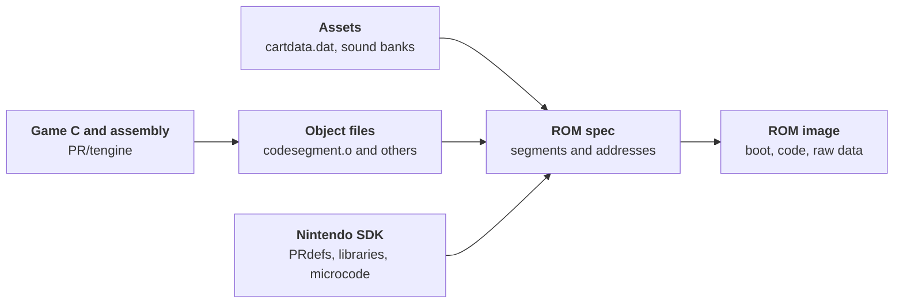

# Turok Dinosaur Hunter from cartridge to code
<section class="rr-game-media-row">
  <figure class="rr-game-figure">
    
    <figcaption>Turok: Dinosaur Hunter box art for the North American Nintendo 64 release.</figcaption>
  </figure>
  <div class="rr-game-media-row__copy" markdown="1">
<p class="rr-game-intro__kicker">Nintendo 64 / 1997 / Iguana Entertainment</p>

**The game.** *Turok: Dinosaur Hunter* is a first-person shooter developed by Iguana and published by Acclaim. It released for Nintendo 64 in North America on **4 March 1997** [^11] [^16]. The comic-book hero crosses the Lost Land, fighting dinosaurs and other enemies while recovering pieces of the Chronoscepter [^12].

**The makers.** Producer David Dienstbier recalled a final game team of **about 17 or 18 people** [^19]. The N64 credits name **Rob Cohen** as lead programmer, **Nigel Cook** as Iguana's creative director, and **Alan D. Johnson** as lead artist. GameFAQs lists **62 numbered credit entries** across specialties, including Acclaim roles and repeated names [^3]. The earlier article's counts of **nine programmers, 22 artists, and more than 61 people overall** cannot be reconciled with the documented core-team figure or verified as Iguana-only headcounts [^13].

**The leak.** In 2017, a preservationist found Turok source code on former Acclaim **SGI Indy workstations** [^15]. He said their previous owner had acquired them at Acclaim's 2004 bankruptcy auction [^15]. A leaked copy surfaced in public discussion in 2018 [^1]. The files do not establish their exact route from those machines into circulation.

**Why it matters.** The original RetroReversing article identified Turok as the **first commercial Nintendo 64 game whose original source code became public** [^13]. The ROM layout, bootstrap loader, asset index, cheats, and Controller Pak code show how cartridge data becomes a running world.

**What survives.** The top level of `PR/tengine` in this copy contains **78 `.c` files, four `.s` files, and one `.cpp` file**. The earlier article described only two or three assembly files; the measured count is four at this level. The source is predominantly C, with assembly for selected low-level routines.
  </div>
</section>

<aside class="rr-source-path" aria-label="Reading source paths" markdown="1">
<p class="rr-source-path__eyebrow">Reading the source paths</p>
<div class="rr-source-path__segments" aria-label="src slash PR slash tengine slash spec">
  <div class="rr-source-path__segment"><code>src</code><span>Supplied archive</span></div>
  <div class="rr-source-path__segment"><code>PR</code><span>Project Reality SDK tree</span></div>
  <div class="rr-source-path__segment"><code>tengine</code><span>Turok game project</span></div>
  <div class="rr-source-path__segment"><code>spec</code><span>ROM layout file</span></div>
</div>

`PR` carries the **Project Reality** codename [^13]. Nintendo's SDK used `/usr/src/PR` for sample programs and `/usr/include/PR` for headers [^14]. Turok's `tengine` directory sits beside those samples. Paths in this article start at the supplied archive's `src` directory, outside this website's repository.
</aside>

---
## The cartridge and what is inside
<section class="rr-game-media-row">
  <figure class="rr-game-figure">
    
    <figcaption>North American Turok cartridge.</figcaption>
  </figure>
  <div class="rr-game-media-row__copy" markdown="1">
The North American cartridge presents the same game art seen on the box. This is the retail medium that the ROM layout in `PR/tengine/spec` targets.

An opened Nintendo 64 cartridge helps locate the ROM chip and edge connector physically. The board below is a **representative NUS-01A-01 board**, not an identified Turok board; it should not be used to infer the components or capacity of this particular copy.
  </div>
</section>

<figure class="rr-game-figure">
  
  <figcaption>Inside a representative Nintendo 64 cartridge. Board identity is visible; its association with Turok has not been established.</figcaption>
</figure>

The retail game was distributed on a **64 Mbit (8 MiB) cartridge** [^17]. The source tree also contains `PR/tengine/rom.rnc`, an 8 MiB file. Its size alone does not prove that it matches every retail cartridge revision. The more useful evidence for this analysis is `spec`, which states which segments a build places in a ROM. Compression helped fit code and assets within that space.

---
# Development environment
The archive mixes production game files with Nintendo's `PR` SDK tree. Keeping those layers separate makes it easier to see which technology Iguana used and which files are sample programs or library support.

## Nintendo 64 SDK and ROM layout
`PR/tengine/Makefile` includes `$(ROOT)/usr/include/make/PRdefs`. The adjacent `spec` file defines boot code, audio and display-list memory, frame buffers, a cartridge cache, a Z-buffer, raw data segments, and the main code segment. It also names Nintendo microcode objects such as `gspF3DEX.NoN.fifo.o`.



The diagram is a reading map for the files, not proof that the supplied archive builds without changes. The `Makefile` contains commented final-build commands, and this article does not claim a reproducible retail build.

## Workstations and authoring tools
The discovery account identifies **SGI Indy workstations** among the surviving Acclaim hardware [^15]. The earlier article, citing a David Dienstbier interview, described **two SGI workstations at Iguana**: one in a common room where artists could test assets in the engine, and one in the lead programmer's office [^9] [^13]. It also described an Ultra 64 development board plugged into an SGI expansion slot, enabling tests without writing a cartridge. These details are historical accounts; the supplied source tree cannot establish the studio's full hardware inventory.

The SDK release notes in `PR/relnotes` discuss **IRIX 5.3 and 6.2**, evidence of the SGI operating environment. An `src/X11` folder is present, but it does not establish which desktop the team used. `PR/tengine/cart.c` has a `WIN32` branch for host-side code. That shows Windows support in part of the toolchain, not that the N64 game was programmed entirely on Windows. The Windows edition, ported by Sculptured Software, has a **26 November 1997 US release** in both GameFAQs and MobyGames [^18] [^20]; the earlier article's 28 February date is not supported by those records. Later footage of **Turok 3** shows Visual Studio on Windows, without establishing its use for the first game [^8].

The `PR/man/F3DEX/README` is dated **15 October 1996**. That date belongs to the bundled **F3DEX microcode release 1.00**, rather than proving a release date for the whole Nintendo 64 SDK. The examined game files use official Nintendo headers, libraries, and microcode; no separate third-party SDK has been identified in those files.

For 3D authoring, `PR/tengine/tengine.h` declares `mf_3dstudio_to_u64`, a matrix named for converting 3D Studio coordinates to Ultra 64 coordinates. That is concrete evidence of a 3D Studio import path. It does not, by itself, identify the exact software version used by every artist. Interviews with the team provide further context [^10].

<figure class="rr-game-figure">
  
  <figcaption>3D Studio 4, shown as an illustration of the period's modeling tools; this is not a screenshot of Iguana's project.</figcaption>
</figure>

```c
// PR/tengine/tengine.h: a coordinate-conversion matrix
CMtxF mf_3dstudio_to_u64;
```

The earlier article noted that **NinGen/MultiGen and Alias** appeared in Nintendo 64 development discussions alongside Softimage, Nichimen, and 3D Studio [^13]. This is period context, not evidence that Turok used every package. Animator Greg Omelchuck later recalled using "3D Studio Max v4" for Turok's dinosaurs [^10]. Autodesk's records place **3D Studio Release 4** in 1994, **3D Studio MAX** on sale by January 1997, and **3ds max 4** in use by January 2001 [^21] [^22] [^23]. The last version postdates Turok's launch, so the exact version behind Omelchuck's recollection remains uncertain. The source's 3D Studio coordinate-conversion code confirms a workflow, not a software version. Whether Iguana kept the same package for later games cannot be established from this archive.

The game also used **Rob Northen's ProPack** compression [^6]. `PR/tengine/cart.c` calls `PackRNC`, while the bootstrap in `boot.c` checks for an RNC header and dispatches to method 1 or 2 decompression. The archive includes unpacking code in `unpack.c` and `rnc2.s`. [Sega Retro's RNC overview](https://segaretro.org/Rob_Northen_compression) provides more format background.

<figure class="rr-game-figure">
  
  <figcaption>RNC ProPack software.</figcaption>
</figure>

The header of `PR/tengine/rnc.s` calls itself **“PROPACK Unpack Source Code - Sony PSX, Method 2”** and records a conversion to SGI assembler on **13 September 1996**. It documents the unpacker's code lineage, not a PlayStation build of Turok. In `boot.c`, the `RNC` signature check applies to the loaded code segment; `cart.c` handles individual asset blocks separately.

A documentary about **Turok 3** shows later Acclaim development equipment, including a **Bung Doctor V64** and Windows tools [^7] [^8]. A contemporary 1997 report priced the V64 at **US$450**, explaining its appeal as a lower-cost test device [^24]. The footage establishes its use during the later production, but does not establish whether Iguana had one while making the first Turok. A separate account identifies an Acclaim **ArtSend debugging cartridge** in the same documentary around the seven-minute mark [^25], so that timestamp alone should not be used to identify the V64.

<figure class="rr-game-figure">
  
  <figcaption>A Doctor V64 in later Turok 3 development footage. It is evidence for that production period, not proof of its use on the original game [^8].</figcaption>
</figure>

---
# Find the game in the archive
The `src/PR` directory contains many SDK examples, including `simple`, `gtdemo`, and `spgame`. The game-specific material is under `src/PR/tengine`. Its `dosvers` directory contains a separate host-side source variant; compiled objects and generated files also appear beside the C and assembly sources.


Start in `tengine` when tracing the game. Follow `spec` for the ROM layout and `cartdir.h` for the asset index. Treat neighboring SDK demo directories as context, not as Turok engine modules.


- boot.c - loads the main code segment and handles an RNC header
- spec - defines ROM segments and memory placement
- cart.c, cart.h, cartdir.h - indexed asset storage, compression, and block names
- ai.c, aidoor.c, aistand.c - enemy behavior and AI support
- scene.c, romstruc.c - world data and runtime structures
- cheats.c, control.c - cheat menu, input, and Controller Pak support
- dosvers/ - host-side source and tools



The tree highlights entry points for investigation, not an exhaustive inventory. For example, `PR/tengine/cartdata.dat` is only 7,576 bytes in this copy, whereas `PR/cartdata.dat` is 6,489,336 bytes and `PR/tengine/oldcartdata.dat` is 6,451,432 bytes. These are distinct files. Use the path and byte size when reporting findings, rather than referring to an unspecified `cartdata.dat`.

The earlier article suggested that `tengine` began as a copied Nintendo SDK demo under `C:\ultra\usr\src\pr` [^13]. The game Makefile does include Nintendo's `PRdefs`, and the archive contains SDK demos beside `tengine`. No matching demo or copied-file history has been identified, so these clues show SDK integration rather than which template, if any, Iguana started from.

---
# How the game data is packed
`PR/tengine/cartdir.h` names eleven root blocks in the asset container. `cart.h` defines a `CIndexedSet`: a big-endian block count followed by offsets. `cart.c` uses adjacent offsets to calculate each stored block's byte length. The first block begins after the aligned index header.

The root blocks in the 6,489,336-byte `PR/cartdata.dat` file are summarized here. These are **stored sizes**; compressed content may expand at runtime.

Block | Content named in cartdir.h | Stored bytes
---|---|---:
0 | Graphic objects | 2,380,400
1 | Object attributes | 9,504
2 | Object types | 1,360
3 | Texture sets | 1,900,192
4 | Particle effects | 11,720
5 | Sound effects | 9,824
6 | Levels | 2,110,736
7 | Persistent counts | 448
8 | Warp destinations | 5,024
9 | Binaries | 60,008
10 | Binary types | 64

Graphic objects, texture sets, and levels account for most stored bytes in this copy. The names tell us how the root directory is organized; they do not imply that every original authoring file or editable 3D Studio scene is present.

**Packed game assets are present; editable art projects are not evident.** `cartdir.h` names geometry and animations under graphic objects, bitmaps and palettes under texture sets, and collision, instances, and grid sections under levels. A search of this supplied `src` tree found no `.3ds` or `.max` scene files. The binary data can drive the game, but these runtime formats are not the original 3D Studio authoring projects. The archive also contains other media files, including audio, so "no assets" would be misleading.

The original article also compared an early **Windows 95 demo** reportedly supplied with issue 28 of the Italian *PC Gamer* (1998). Its asset file was called `demodata.dat`; the author reported RNC-compressed sections and a layout resembling the N64 `cartdata.dat` [^13]. That demo file is not in this supplied source tree, so the comparison remains an account from the earlier investigation rather than a result reproduced here.

## Explore the index yourself
The viewer starts with the real root offsets from `PR/cartdata.dat`. Select a local copy of a root `cartdata.dat` to inspect its eleven block sizes. It reads only the header in your browser; it does not upload the file or decompress assets.

<div class="rr-turok-index" data-rr-turok-index>
  <div class="rr-turok-index__controls">
    <label for="rr-turok-index-file">Choose a local cartdata.dat file</label>
    <input id="rr-turok-index-file" type="file" accept=".dat">
    <button type="button" data-rr-turok-reset>Restore sample</button>
  </div>
  <p data-rr-turok-status aria-live="polite">The sample shows eleven root blocks from PR/cartdata.dat.</p>
  <div data-rr-turok-rows></div>
</div>
<script defer src="/public/js/turok-cart-index.js"></script>

A quick manual check is to read the first four bytes of `PR/cartdata.dat`: `00 00 00 0B` is eleven in big-endian order. The next word, `00 00 00 38`, places the first block at offset 56. `cartdir.h` maps block zero to graphic objects. This is a useful starting point before trying to parse the nested sets.

## From ROM to running code
`PR/tengine/spec` names the nearby `tengine/cartdata.dat` in a raw `static` segment. That 7,576-byte file is distinct from the much larger `PR/cartdata.dat` explored above; the spec alone does not show how the larger file would enter this build. `boot.c` separately loads the main code segment from ROM. It first reads twelve bytes and checks for the ASCII `RNC` signature. If present, it reads the compressed length, transfers the compressed block, then calls the method 1 or method 2 unpacker. Otherwise it copies the code segment directly. It then clears caches and BSS before calling `boot()`.

```c
// PR/tengine/boot.c: the decision at the start of BootEntry
DecompFlag = ((_codeSegmentStart[0] == 'R') &&
              (_codeSegmentStart[1] == 'N') &&
              (_codeSegmentStart[2] == 'C'));
```

This distinction matters: the bootstrap's RNC check is for the **code segment**, while `cart.c` also supports compression of individual asset blocks. An RNC header in one place does not mean the entire `cartdata.dat` file is a single RNC stream.

---
# Game systems visible in the source
The archive is more than a ROM packaging exercise. Its game modules expose systems that can be followed from input through state changes to rendering and saving.

## Cheats and menu drawing
`PR/tengine/cheats.c` contains the menu state, selection logic, cheat flag toggles, and draw calls. In `CCheat__Draw`, the game draws a translucent box, places a highlight bar using `m_RealSelection`, and renders the enabled option text. `CCheat__Update` handles moving the selection and toggling flags such as invincibility and unlimited ammo.

<figure class="rr-game-figure">
  
  <figcaption>The cheat menu as shown by <a href="https://tcrf.net/Turok:_Dinosaur_Hunter_(Nintendo_64)">The Cutting Room Floor</a>; the menu implementation is in <code>cheats.c</code>.</figcaption>
</figure>

The three draw steps from `CCheat__Draw` show how this screenshot is assembled. First, the menu background is a black box with alpha scaled by `m_Alpha`:

```c
// PR/tengine/cheats.c: menu background
COnScreen__InitBoxDraw(ppDLP);
COnScreen__DrawHilightBox(ppDLP,
    CHEAT_X, CHEAT_Y,
    CHEAT_X + CHEAT_WIDTH, CHEAT_Y + CHEAT_HEIGHT,
    1, FALSE, 0, 0, 0, 200 * pThis->m_Alpha);
```

Next, the selected row gets a bar inset by eight pixels horizontally. Its vertical position depends on `m_RealSelection` and the current menu spacing:

```c
// PR/tengine/cheats.c: selected row
CPause__InitPolygon(ppDLP);
CPause__DrawBar(ppDLP,
    CHEAT_X + 8,
    CHEAT_Y + CHEATMENU_Y + (pThis->m_RealSelection * CHEATMENU_SPACING),
    CHEAT_WIDTH - 16, CHEATMENU_SPACING, pThis->m_Alpha);
```

Finally, the draw loop skips unavailable items and advances the text baseline for each visible cheat:

```c
// PR/tengine/cheats.c: option labels
COnScreen__InitFontDraw(ppDLP);
COnScreen__SetFontScale(0.7, CHEAT_SCALE);
COnScreen__SetFontColor(ppDLP, 200, 200, 200, 200, 200, 200);
yStart = CHEAT_Y + CHEATMENU_Y;
for (i = 0; i < CHEAT_END_SELECTION; i++) {
    if (cheat_menu_items[i]) {
        COnScreen__DrawText(ppDLP, cheat_text[i], 320/2, yStart,
            (int)(255 * pThis->m_Alpha), TRUE, FALSE);
        yStart += CHEATMENU_SPACING;
    }
}
```

These are whitespace-normalized excerpts from `cheats.c`; the calculations and calls match the source.

For a focused reading exercise, find `CCheat__Update` and follow one flag into `CCheat__Draw` and the game system that consumes it. The source distinguishes flags that are enabled for display from flags that are active in play.

## Controller Pak saves
`PR/tengine/control.c` holds `OSPfs ControllerPak`, directory state, and the game's Controller Pak identifiers. Its `GameCode` is `NTUE` and its `CompanyCode` is `51`. The `GameName` array in this copy uses encoded byte values, rather than the plain ASCII `turok` array left in a comment. The save payload is modeled by `CPersistantData` in `tengine.h`, including inventory, level keys, settings, health, and cheat flags.

`control.h` declares the SDK's `OSPfs` handle and `OSPfsState`, plus file counts, free pages, and a directory of `t_File` records. Each record carries an index, a 20-character string, and a page count:

Nintendo's manual calls each Controller Pak save a **game note**. Its **PFS** file system uses `OSPfs` as the file handle and manages data in 32-byte units [^26]. This explains the `Pfs` names in the code without needing to infer a longer expansion of the acronym.

```c
// PR/tengine/control.h: Controller Pak directory state
extern OSPfs ControllerPak;
extern OSPfsState FileState;
extern s32 FilesUsed, MaxFiles;
extern s32 TurokFiles;
extern s32 FreePages;
typedef struct s_File {
    int index;
    char string[20];
    int pages;
} t_File;
extern t_File FileDirectory[];
```

The bundled SDK header `PR/tengine/u64inc/os.h` defines the file state returned by its Pak APIs. The record includes a byte size, game and company identifiers, and the names stored with the note:

```c
typedef struct {
    u32 file_size;
    u32 game_code;
    u16 company_code;
    char ext_name[4];
    char game_name[16];
} OSPfsState;
```

The actual identifier declarations in `control.c` are worth checking against a Pak dump. The readable ASCII name appears only as a commented-out alternative:

```c
u16 CompanyCode = '51';
u32 GameCode = 'NTUE';
// char GameName[16] = {'t', 'u', 'r', 'o', 'k', 0,0,0,0,0,0,0,0,0,0,0};
char GameName[16] = {0x2d, 0x2e, 0x2b, 0x28, 0x24, 0,0,0,0,0,0,0,0,0,0,0};
char ExtName[4] = {0,0,0,0};
```

The complete `CPersistantData` declaration is preserved below. Its fields include weapon ownership and ammunition, level keys, player options, cheat flags, health, checkpoints, and boss state. The field names are as written in the source, including `Persistant`.

<details markdown="1">
<summary>Show the full save-data structure from tengine.h</summary>

```c
typedef struct CPersistantData_t
{
    BOOL    SemiAutomaticPistolFlag,    // weapons owned flags
            RiotShotgunFlag,
            AutomaticShotgunFlag,
            AssaultRifleFlag,
            MachineGunFlag,
            MiniGunFlag,
            GrenadeLauncherFlag,
            TechWeapon1Flag,
            RocketFlag,
            ShockwaveFlag,
            TechWeapon2Flag,
            ChronoSceptorFlag ;

    BOOL    ArmorFlag,                      // miscellaneous inventory flags
            BackPackFlag ;

    int BulletPool,                     // weapons ammo
            ShotgunPool,
            EnergyPool,
            ExpTekBowAmmo,
            ExpShotgunPool,
            TekBowAmmo,
            MiniGunAmmo,
            GrenadeLauncherAmmo,
            RocketAmmo,
            TechWeapon2Ammo,
            ChronoSceptorAmmo;

    int ArmorAmount ;

    int WeaponUsing ;

    int Level2Keys,
            Level3Keys,
            Level4Keys,
            Level5Keys,
            Level6Keys,
            Level7Keys,
            Level8Keys ;
    int Level2Access,
            Level3Access,
            Level4Access,
            Level5Access,
            Level6Access,
            Level7Access,
            Level8Access ;
    int ChronoSceptorPieces ;

    int Difficulty ;


    BOOL    RunWalk ;                       // TRUE for RUN
    BOOL    ControlSide ;                   // TRUE for right handed
    BOOL    Blood ;                         // TRUE for blood is on
    BOOL    Stereo ;                            // TRUE for stereo
    u32 MusicVolume ;
    u32 SFXVolume ;
    u32 Opacity ;
    u32 HAnalog ;
    u32 VAnalog ;
    u32 CheatFlags ;
    u32 EnabledCheatFlags ;

    int Health,
            MaxHealth,
            Tokens,
            Lives ;

    u16 Checkpoint ;

    float   BestTrainTime ;

    INT32   BossFlags ;

    u32 Crash ;

} CPersistantData;
```

</details>

<figure class="rr-game-figure">
  
  <figcaption>Nintendo 64 Controller Pak, used for Turok save files.</figcaption>
</figure>

A saved `.mpk` file from an emulator can be inspected with a hex editor or a [Controller Pak editor](https://rawgit.com/bryc/mempak/master/index.html). Compare the directory entry and game code before interpreting the payload. The C structure alone is not a complete on-disk format specification.

## Models, worlds, and related games
The 3D Studio conversion matrix in `tengine.h` connects the game runtime to its art pipeline. `scene.c`, `romstruc.c`, and `cartdir.h` provide better starting points for tracing geometry, collision, and level data than the generic SDK demo folders.

Iguana also built a world editor, according to a contemporary interview. David Dienstbier described the tools this way: "All of the tools for this game were created internally; the world editor, how the animation is handled, everything we have, we created here" [^4]. No obvious world-editor project or executable was found in this supplied `src` tree. Nightdive's Stephen Kick said the remaster team could not find the original game's source code when it began its work [^27]. The later remaster has an editor [^28], but neither that fact nor this archive establishes a lineage back to Iguana's tool. A claim that the original editor has *never* been released would require a broader survey than this archive permits.

The first *South Park* Nintendo 64 game is reported to have been based on Turok technology [^9]. Shared engine code is therefore plausible, although this archive does not establish which exact source files were compiled for *South Park*.

<figure class="rr-game-figure">
  
  <figcaption>The later South Park game on Nintendo 64. Its reported engine relationship is historical context, not evidence that every Turok module was reused.</figcaption>
</figure>

---
# Reproducing the investigation
The paths in this page are enough to repeat the main checks without running an old SDK. Begin with `PR/tengine/spec` to identify segments, then `boot.c` for code loading. Read `cart.h` and `cartdir.h` before inspecting `PR/cartdata.dat`; the root index is big-endian and contains offsets rather than file names. Use `cheats.c` and `control.c` for two small, self-contained game systems.

The archive includes generated objects and a ROM image, but a clean rebuild depends on an appropriate historical toolchain and inputs. The earlier build notes below record obstacles encountered with one setup. They are observations, not verified fixes for every environment.

<details markdown="1">
<summary>Historical build notes from the earlier version of this article</summary>

The earlier attempt copied `stddef.h` from Dragon SDK into `c:/ultra/GCC/MIPSE/INCLUDE` and changed a `NULL` definition at approximately line 400 of that header after seeing `trex.c:229: invalid operands to binary |` [^13]:

```c
// #define NULL ((void *)0)
#define NULL 0
```

That records the historical environment and workaround; the line number depends on the exact header version, and the edit does not establish a correct fix for another toolchain.

```text
as -o adpcm.o adpcm.s
adpcm.s: Assembler messages:
adpcm.s:96: Error: ERROR: Illegal operands `sub'
```

The earlier attempt continued with the archive's existing `adpcm.o`. It also recorded these diagnostics:

```text
Warning: type of symbol `osWritebackDCacheAll' changed from 2 to 1 in codesegment.o
Warning: type of symbol `osInvalICache' changed from 2 to 1 in codesegment.o
```

Reusing an object from the archive can change the resulting binary and does not demonstrate a clean source rebuild.

</details>

---
# Video companions
The original article featured **Turok 64 Official Source Code Found** and [The Making of Turok Dinosaur Hunter for Nintendo 64](https://www.twitch.tv/videos/125480737). Their two-item video carousel is restored here, after the article so the opening still begins with the game's box art. The source video's creator and current availability could not be verified from the supplied archive.



---
# References
[^1]: [Turok Forums discussion of the source archive](https://www.turokforums.com/index.php?topic=645.0)
[^2]: [Community discussion of the discovered source code](https://www.reddit.com/r/gamedev/comments/5nxqi9/n64_turok_dinosaur_hunter_source_code_discovered/)
[^3]: [Turok credits at GameFAQs](https://gamefaqs.gamespot.com/n64/199130-turok-dinosaur-hunter/credit)
[^4]: [IGN interview with the creator of Turok](https://www.ign.com/articles/1997/01/16/interview-with-the-creator-of-turok)
[^5]: [Turok remaster on Steam](https://store.steampowered.com/app/405820/Turok/)
[^6]: [Rob Northen Compression technical notes](https://wiki.multimedia.cx/index.php/RNC_ProPack)
[^7]: [Archived Turok 3 development equipment discussion](https://web.archive.org/web/20001119222300/http://www.dextrose.com:80/info/0428turok3dev.htm)
[^8]: [Video Games: Creating Virtual Fantasy documentary excerpt](https://youtu.be/dJXHyXxM0fg?t=1659)
[^9]: [The making of Turok Dinosaur Hunter](https://www.gamesradar.com/uk/the-making-of-turok-dinosaur-hunter/)
[^10]: [Nintendo Life interview on making Turok](http://www.nintendolife.com/news/2016/05/feature_the_making_of_turok_dinosaur_hunter)
[^11]: [Turok: Dinosaur Hunter release and credits at MobyGames](https://www.mobygames.com/game/2203/turok-dinosaur-hunter/)
[^12]: [Turok game description on Steam](https://store.steampowered.com/app/405820/Turok/)
[^13]: [Original RetroReversing Turok source code article](https://frds.github.io/turok64sourcecode)
[^14]: [Nintendo 64 SDK OS 2.0J release notes](https://ultra64.ca/files/documentation/online-manuals/man/n64man/relnote_j/index.htm)
[^15]: [2017 report on Turok source code found on former Acclaim workstations](https://www.gamedeveloper.com/game-platforms/source-code-for-i-turok-i-and-i-nba-jam-extreme-i-surfaces)
[^16]: [Turok: Dinosaur Hunter Nintendo 64 release details at GameFAQs](https://gamefaqs.gamespot.com/n64/199130-turok-dinosaur-hunter/data)
[^17]: [Nintendo64Ever Turok cartridge data sheet](https://www.nintendo64ever.com/Nintendo-64-Game%2C924%2CTurok-Dinosaur-Hunter.html)
[^18]: [Turok: Dinosaur Hunter PC release details at GameFAQs](https://gamefaqs.gamespot.com/pc/199129-turok-dinosaur-hunter/data)
[^19]: [David Dienstbier's recollection of Turok's team size in an oral history](https://melmagazine.com/en-us/story/turok-dinosaur-hunter-oral-history)
[^20]: [Turok: Dinosaur Hunter Windows release details at MobyGames](https://www.mobygames.com/game/2203/turok-dinosaur-hunter/releases/windows/)
[^21]: [Autodesk's report on 3D Studio Release 4](https://investors.autodesk.com/index.php/index.php/static-files/c0513bc9-648d-4eb2-8b7c-ac4248979b68)
[^22]: [Autodesk fiscal 1997 report on 3D Studio MAX sales](https://investors.autodesk.com/static-files/a9698cb5-9fdc-4557-b46a-162dfaf5a27d)
[^23]: [Autodesk account of 3ds max 4 in use by January 2001](https://investors.autodesk.com/news-releases/news-release-details/discreet-software-corrects-and-replaces-previous-announcement)
[^24]: [1997 Wired report on the Doctor V64's US price](https://www.wired.com/1997/06/nintendo-pirating-device-still-for-sale/)
[^25]: [Behind the Code's identification of Acclaim's ArtSend cartridge in the Turok 3 footage](https://www.behindthecode.ca/in-the-works-acclaim-artsend-dev-cart/)
[^26]: [Nintendo 64 SDK Controller Pak file-system manual](https://ultra64.ca/files/documentation/online-manuals/man/n64man/os/osPfsInit.html)
[^27]: [Nightdive's Stephen Kick on the Turok remaster and missing original source](https://www.rpgsite.net/interview/17342-system-shock-2-25th-anniversary-remaster-interview-nightdive-studios-stephen-kick-switch-2-upgrade-doom-rpg-blood-2-nolf-deftones)
[^28]: [Nightdive Turok remaster level editor announcement](https://www.gamespot.com/articles/see-turok-pc-remasters-level-editor-in-action-out-/1100-6446653/)
