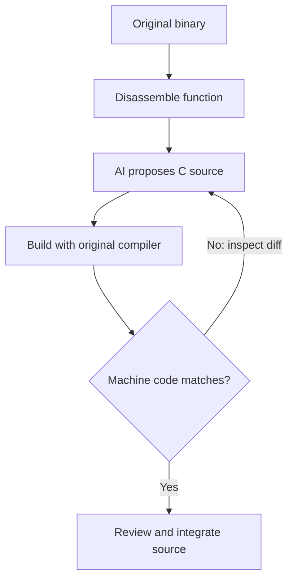

AI can help a reverse engineer turn a game executable into readable C, identify unknown functions, and search for source code that recreates the original machine instructions. The last task is particularly interesting for retro games: an AI agent can write C, run the original compiler, inspect the differences and try again.

The important distinction is between **code that looks plausible**, **code that behaves correctly**, and **code that compiles to the same bytes**. Newer language models are making the third task more practical, but a compiler and a byte comparison remain the final authority.

This guide explains the approach using Nintendo 64 and PlayStation examples, including what recent Claude Opus 5.5 benchmark results actually demonstrate.

For the underlying disassembly, intermediate representations and source reconstruction, start with the existing explanation:



## Glossary of Key Terms
The following terms are useful when reading decompilation projects and benchmarks:
* <a id="glossary-llm"></a>**LLM (large language model)** - A model that can reason about disassembly, pseudocode and source, but does not intrinsically prove that its output is correct.
* <a id="glossary-abi"></a>**ABI (application binary interface)** - Rules for registers, function arguments, return values, stack layout and related binary-level conventions.
* <a id="glossary-ido"></a>**IDO** - The SGI compiler family used in many Nintendo 64 workflows; matching projects commonly use precisely identified IDO versions.
* <a id="glossary-mcp"></a>**MCP (Model Context Protocol)** - An interface through which an agent can access external tools such as a decompiler.
* **Matching decompilation** - Writing source code that reproduces a chosen portion of the original compiled binary, using an appropriate historical toolchain.

---
# What Can AI Actually Decompile?
Ordinary decompilers such as [Ghidra](/ghidra) recover a C-like representation using program analysis. An [LLM](#glossary-llm) can interpret that output and propose names, structures or source changes. These are useful but different activities.

The main kinds of AI assistance are:
* **Binary understanding** - Explain a function, infer the role of a buffer, identify a game subsystem or suggest descriptive names.
* **Pseudocode cleanup** - Turn awkward decompiler output into readable C or C++, ideally preserving the behaviour shown by the assembly.
* **Functional reconstruction** - Write code that passes tests or behaves like the executable when run.
* **Matching decompilation** - Change source until a compiler emits the same machine code as the game.

The final two goals have different success criteria. Many distinct C expressions can produce equivalent results; compiler choices can also change registers, stack frames and instruction order. Matching code is therefore not necessarily identical to the game's original source, nor is matching code automatically easy to understand.

For an introduction to the broader decompiler landscape, see [Decompilers - A Deep Dive](/decompilers).

---
# How an AI Matching Agent Works
The key advance is **tool-assisted iteration**, not simply asking a model to translate assembly into C. Agents can inspect the target, edit source, invoke an exact compiler and read an instruction-level diff.

A typical matching loop looks like this:



The agent should be given reliable constraints before generating source:
* The target CPU and [ABI](#glossary-abi), including argument and return registers.
* Function boundaries, references, globals and known structure definitions.
* The compiler version, options, assembler and relevant object-file conventions.
* The target assembly and a way to compile and compare candidates.
* Any uncertainty about the target's original types and surrounding code.

A language model cannot recover comments, original variable names or the developer's exact choice of syntax from machine code alone. Byte matching provides a measurable outcome without claiming to recover those missing details [^1].

## Why the Original Compiler Matters
A correct implementation compiled with a modern GCC or Clang may not match a 1990s game. Even compiler releases from the same family may choose different instructions or schedule them differently.

For Nintendo 64 work, the [IDO](#glossary-ido) version and flags are often central to producing matching MIPS instructions. PlayStation projects may instead rely on a specific GCC/PSY-Q toolchain and assembler configuration. The differences are not cosmetic: calling conventions, optimization passes and assembly translation all affect the final bytes.

RetroReversing has a separate reference on historical toolchains and their compiler fingerprints:



## Worked Example - Signed and Unsigned MIPS Comparisons
Consider the following *illustrative* MIPS function. This is a teaching example, not a disassembly from a particular commercial game or a verified IDO build:

```nasm
sltu  $v0, $a0, $a1
jr    $ra
nop
```

Under the normal MIPS calling convention, `$a0` and `$a1` hold the first two integer arguments, and `$v0` holds the return value. The important instruction is `sltu`: it compares its operands as **unsigned** integers and returns 1 when the first is smaller.

An AI model might produce this initially:

```c
int is_less(int a, int b) {
    return a < b;
}
```

That source expresses a **signed** comparison. With 32-bit values `a = 0xFFFFFFFF` and `b = 1`, the signed comparison is true, while the unsigned comparison is false. The machine instructions `slt` and `sltu` encode different semantics.

A better source hypothesis is:

```c
#include <stdint.h>

int is_less(uint32_t a, uint32_t b) {
    return a < b;
}
```

The type correction explains the instruction's semantics, but **it is not yet proof of a byte match**. The next step is to compile with the project's actual historical toolchain and compare the output. If the compiler emits different instructions, the agent must investigate the compiler flags, function signature, surrounding context or source structure.

This is the fundamental feedback loop: use the binary to reject a convincing but wrong reconstruction, then use the compiler to test the corrected hypothesis.

---
# Tools for an AI Decompilation Workflow
AI agents generally build on tools developed by traditional decompilation communities. The following tools cover distinct parts of the process:

Tool | What it contributes
---|---
[Ghidra](https://github.com/NationalSecurityAgency/ghidra) | Disassembly, pseudocode, cross-references and type recovery
[GhidrAssist](https://github.com/jtang613/GhidrAssist) | Language-model assistance and agentic analysis within Ghidra
[splat](https://github.com/ethteck/splat) | Split ROMs into assets and code sections
[m2c](https://github.com/matt-kempster/m2c) | Generate a starting C-like translation from MIPS assembly
[asm-differ](https://github.com/simonlindholm/asm-differ) | Display instruction-level differences between target and compiled output
[decomp-permuter](https://github.com/simonlindholm/decomp-permuter) | Search for source-code variations that improve a match
[ido-static-recomp](https://github.com/decompals/ido-static-recomp) | Run statically recompiled historical IDO compilers in supported N64 workflows
[decomp.me](https://decomp.me/) | Experiment with compiler-backed matching decompilation in a browser

A tool that explains Ghidra pseudocode and a tool that autonomously writes matching C are not interchangeable. The latter needs a real build environment, not just a text-generation interface.

## Practical Starting Point - An N64 Decompilation Agent
The [bigyoshi51/decomp project](https://github.com/bigyoshi51/decomp) is a Nintendo 64 agent that combines Claude with `splat`, `m2c`, `asm-differ`, `decomp-permuter` and a historical IDO compiler. It operates against an **existing** decompilation project rather than discovering the full layout of an arbitrary ROM on its own [^2].

Its README documents Python 3.12+, `uv`, an existing buildable N64 project and an `ido-static-recomp` installation. After configuring `decomp.yaml`, it exposes useful manual inspection commands:

```bash
# Find candidate functions, starting with the smallest
uv run python -m decomp.main discover --sort-by size

# Produce initial C-like output for a chosen function
uv run python -m decomp.main m2c <function_name>

# Compare the compiled candidate with the target
uv run python -m decomp.main diff <function_name>
```

These commands are from the project's documentation, not the result of a test run for this article. The `<function_name>` placeholders must be replaced with a symbol from the configured project. The automated agent loop is described separately in the repository.

A useful first experiment is a small function with known calling conventions and no complicated global state. Check the diff after each edit and keep the exact compiler command alongside any matching result.

---
# Case Study - Brave Fencer Musashi on PlayStation
One of the more detailed published accounts of AI-assisted game decompilation comes from [BFM-decomp](https://github.com/Druthulu/BFM-decomp), targeting Square's 1998 [PlayStation](/ps1) game *Brave Fencer Musashi*.

The project's maintainers report **218 byte-identical code binaries**, including the main executable, resident engine and location overlays. Their reported verification method recompiles the project against the owner's disc and checks the resulting binaries, rather than counting source files that merely compile [^3].

The project describes a workflow in which:
* Claude Code drives Ghidra through [MCP](#glossary-mcp) to investigate functions and game memory structures.
* PCSX-Redux provides runtime evidence for addresses and loaded overlays.
* A pinned GCC 2.7.2-derived toolchain, assembler settings and binary comparison act as the matching checks.
* A compiler-idiom cookbook records patterns discovered during iterative matching.
* Human approval gates and recorded project decisions constrain the agent's work.

The [project history](https://github.com/Druthulu/BFM-decomp/blob/main/docs/story.md) is more informative than a bare completion percentage because it explains the infrastructure, failed approaches and later cleanup [^4].

There are important qualifications. The maintainers explicitly distinguish their C reconstruction from Sony SDK library objects and retained hand-written assembly. They also describe ongoing readability work involving generated names, types and register hints. In other words, **a verified matching build does not automatically mean the source is clean or fully understood**.

This is a project-reported result. The repository provides a reproduction procedure for owners of the relevant game disc; no independent reproduction is claimed here.

---
# Claude Opus 5.5 and the Retrobench Results
Anthropic released **Claude Opus 5.5 on 22 September 2026**, describing improvements in coding and agentic workflows [^5]. For game decompilation, the more relevant evidence is not a general coding benchmark but the model's performance in a compiler-backed matching task.

[Retrobench](https://retrobench.ai/), created by Sinan Onur Altinuc, evaluates models on five Nintendo 64-era MIPS targets. Each agent receives assembly, necessary headers and the historical IDO compiler, then writes C and iterates against a byte comparison. Its reported score is the **mean of the five per-target byte-match percentages**, not the percentage of an entire game recovered [^6].

The Retrobench v0.4.9 leaderboard reported the following results for Opus 5.5:

Target | What it tests | Opus 5.5 byte match
---|---|---
PEBBLE | Small unoptimized leaf function | 100%
ATLAS | Multi-function module with a non-canonical variant | 100%
FORGE | Optimized function with external calls | 100%
TEMPEST | Floating-point and spatial logic | 99.6%
COLOSSUS | Large graphics-related module | 92.2%
**Mean** | **Five targets, equally weighted** | **98.4%**

The benchmark's archive reports **81.6% for Opus 5** on the common v0.4 instrument. That is a substantial reported difference, although an agent benchmark also reflects the harness, tool access and run conditions, not just model weights. Retrobench explicitly notes that difficult targets can vary between runs and that small score differences should not be treated as a decisive ranking [^6].



## What the Benchmark Does Not Prove
Three of Opus 5.5's five listed targets reached an exact match. The remaining two did **not** reach 100%, even though their partial byte-match scores were high. A 99.6% result is a near match, not a completed matching function.

The benchmark has important boundaries:
* Five targets are a small sample, not an estimate of success across every commercial game.
* Its experiments focus on N64/MIPS with IDO, not PlayStation, GameCube or arbitrary PC binaries.
* The source games and function identities are withheld, limiting independent inspection of the target set.
* Partial byte similarity is useful feedback but does not establish functional equivalence.
* The reported results come from the benchmark operator; they should not be confused with a peer-reviewed general claim about autonomous game reconstruction.

The observed acceleration is interesting and measurable within this test. Calling it proof that Opus 5.5 can autonomously decompile entire games would go beyond the evidence.

---
# What Academic Research Tells Us
AI decompilation research uses several different notions of quality. Comparing their headline scores without checking the evaluation task can be misleading.

## LLM4Decompile
The 2024 [LLM4Decompile paper](https://aclanthology.org/2024.emnlp-main.203/) introduced models for binary-to-source generation and for refining traditional decompiler output. Its evaluation included **re-executability**, asking whether generated programs could be compiled and run successfully on the benchmark's tasks [^7].

This is useful evidence that specialized models can improve over plain pseudocode. It is not a measurement of whether the original N64 or PS1 machine instructions were reproduced.

## DecompileBench
The 2025 [DecompileBench study](https://aclanthology.org/2025.findings-acl.1194/) evaluated 23,400 functions from 130 programs, combining runtime-aware validation and an assessment of code understandability. The authors reported that their tested LLM-based approaches could produce more understandable code while showing **52.2% lower functional correctness** than the commercial decompilers in the comparison [^8].

The lesson is not that language models are useless. Readability, recompilation, test coverage and matching are separate measurements; a model can score well on one and fail another.

## BinMetric
[BinMetric](https://www.ijcai.org/proceedings/2025/858) evaluates language models on binary-analysis tasks rather than limiting the investigation to reconstructing matching C. It is a complementary reference for assessing whether an agent understands the program it is modifying [^9].

---
# Limitations and Good Practices
AI is useful when it proposes hypotheses that tools can check. It is unreliable when plausible prose is mistaken for evidence.

For retro game projects, common failure modes are:
* **False types or signedness** - A wrong cast can change a comparison or memory access without looking suspicious in C.
* **Incorrect compiler assumptions** - Optimization flags, assembler behaviour, struct packing and compiler versions affect matching bytes.
* **Missing game context** - Overlays, SDK libraries, hardware registers and game-specific calling conventions may not be visible in one function.
* **Overfitting to the diff** - A source change might improve matching bytes while obscuring or misunderstanding the original behaviour.
* **Code that matches but is hard to maintain** - Generated names and register-forcing tricks can remain even after a successful rebuild.
* **Unclear provenance** - Benchmarks and project progress figures need dated versions, input constraints and reproducible checks.

Keep a short record with each candidate: target binary and address, architecture, compiler command, source revision, comparison output and any human edits. Use emulator tests when behaviour also matters. When sending game binaries or disassembly to a hosted AI service, consider the game's copyright, any confidentiality obligations and the provider's data-handling terms.

For projects intended to be shared publicly, follow the target repository's rules on distributing original ROMs, executables, SDK material and extracted assets.

---
# Where to Go Next
The most productive approach is to start with traditional tools, use AI to accelerate the parts that require interpretation, and let compilation and runtime checks decide what is correct.

Useful resources for a first project include:
* [decomp.me FAQ](https://decomp.me/faq) - Understand the mechanics and terminology of matching decompilation.
* [How Decompilers Work](/how-decompilers-work) - Learn how disassembly becomes readable pseudocode.
* [N64 Decompiling with Ghidra](/n64-decompiling) - Import and inspect a Nintendo 64 ROM.
* [C/C++ Compiler Toolchains](/compilers) - Identify the compilers and SDKs used by retro game developers.
* [bigyoshi51/decomp](https://github.com/bigyoshi51/decomp) - Explore a documented N64 compiler-feedback agent.
* [BFM-decomp retrospective](https://github.com/Druthulu/BFM-decomp/blob/main/docs/retrospective.md) - Read a detailed account of an agent-assisted PlayStation decompilation.

---
# References
[^1]: [decomp.me - Matching Decompilation FAQ](https://decomp.me/faq).
[^2]: [bigyoshi51/decomp - README](https://github.com/bigyoshi51/decomp/blob/main/README.md).
[^3]: [Druthulu/BFM-decomp - README and verification instructions](https://github.com/Druthulu/BFM-decomp/blob/main/README.md).
[^4]: [BFM-decomp - Project History](https://github.com/Druthulu/BFM-decomp/blob/main/docs/story.md).
[^5]: [Anthropic - Introducing Claude Opus 5.5, September 22, 2026](https://www.anthropic.com/claude-opus-5-5).
[^6]: [Retrobench - AI Decompilation Benchmark, v0.4.9](https://retrobench.ai/).
[^7]: [Tan et al. - LLM4Decompile, EMNLP 2024](https://aclanthology.org/2024.emnlp-main.203/).
[^8]: [Gao et al. - DecompileBench, ACL 2025](https://aclanthology.org/2025.findings-acl.1194/).
[^9]: [BinMetric - IJCAI 2025](https://www.ijcai.org/proceedings/2025/858).
