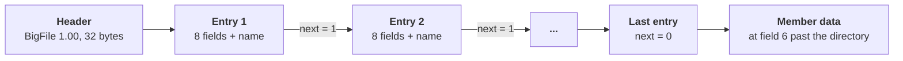
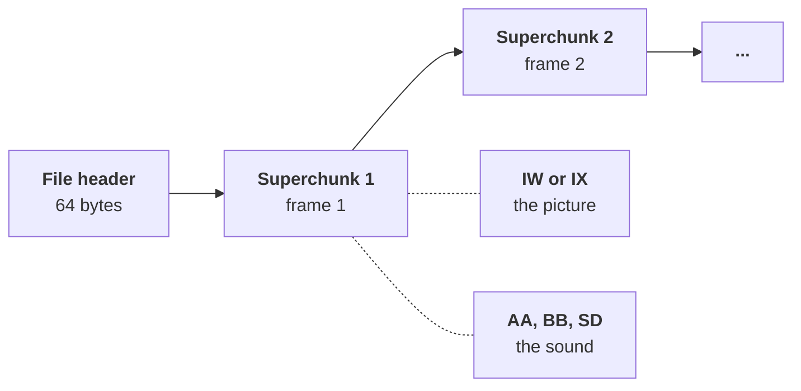
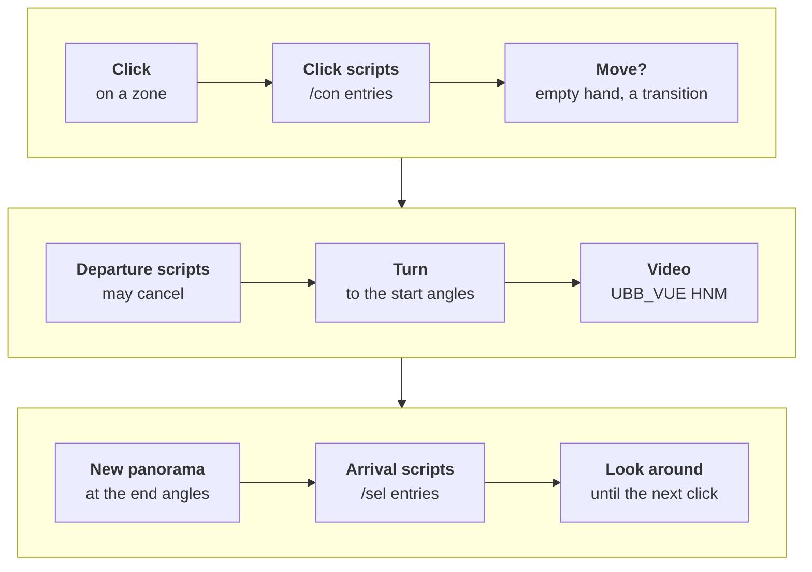
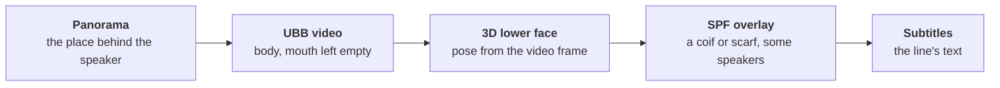
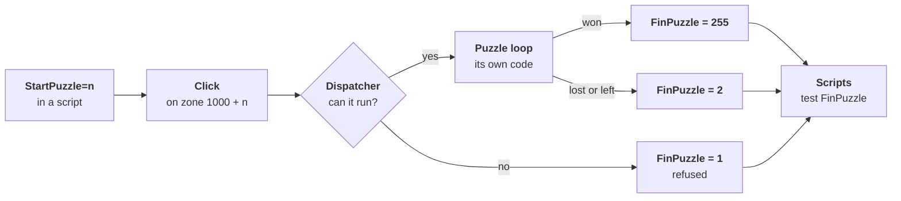

**Atlantis: The Lost Tales** is a first-person fantasy adventure game developed and published by **Cryo Interactive Entertainment** in 1997, with Interplay publishing it in North America [^1].
This page looks at the engine of its [Windows](/pc) version: the archive format, the panoramas and videos, the sound, the place files, the scripts and the 3D talking heads.

The game was a commercial success and started a series that continued with Atlantis II, Atlantis III and Atlantis Evolution [^1].
Many of its file formats are shared with [Versailles 1685](https://en.wikipedia.org/wiki/Versailles_1685), another first-person Cryo game of the same period, which the ScummVM project supports with its CryOmni3D engine [^4].



---
## Glossary of Key Terms
The engine uses a lot of Cryo-specific names, so this quick glossary should help:
* <a id="glossary-big"></a>**BIG** - Cryo's archive format, `BIGCD1.BIG` to `BIGCD4.BIG`, one per CD.
* <a id="glossary-hnm6"></a>**HNM6** - Cryo's 16-bit picture and video container, used for both the panoramas and the full-screen videos.
* <a id="glossary-apc"></a>**APC** - Cryo's 4-bit ADPCM sound format.
* <a id="glossary-ubb"></a>**UBB** - The 8-bit video format of the dialog scenes, with a compositor stream for drawing the character over the panorama.
* <a id="glossary-wam"></a>**WAM** - A place file: the nodes of an area, their transitions, clickable zones and sounds.
* <a id="glossary-con"></a>**CON** - The text scripts that drive the story, the dialogs and the game variables.
* <a id="glossary-warp"></a>**Warp** - Cryo's name for the panoramic view and its projection.

---
# How the game plays
The player is Seth, the queen's new guard, who arrives in Atlantis just as Queen Rhea disappears, and the adventure follows his search for her [^1].
Everything is seen through his eyes, and the whole game is played with the mouse.

The world is a network of fixed viewpoints.
At each one, the player stands still and turns freely in a full circle, and a little up and down, by moving the mouse.
The cursor animates over places Seth can go to, people he can talk to and things he can use.
A click on a direction plays a short video of Seth walking to the next viewpoint, where the player can look around again.

Talking to someone opens a dialog scene.
The character appears in front of the background, speaks with a recorded voice and subtitles, and the player picks what to talk about from a menu of subjects.
A right click opens an inventory bar along the bottom of the screen, where objects picked up along the way can be selected and used.
Companions who travel with Seth for a while appear as portraits on screen.

The story moves forward through chapters, with full-screen cinematics at its key moments and seventeen puzzles, each a small game of its own.
The game saves on its own at the start of each chapter.

Each of these moments is made of a few kinds of data, which the rest of this page looks at one by one:

What the player sees|What the engine uses|Files
---|---|---
Looking around a viewpoint|A cylindrical panorama projected on screen, with animated sprites|`CYCLO\*.HNM`, `SPRITE\*.SPW`
Where the cursor reacts|Rectangles on the panorama, each with an action number|`WAM\*.WAM`
Walking to another viewpoint|A turn of the view, then a video between the two panoramas|`UBB_VUE\*.HNM`
What happens on arrival or after a click|The chapter scripts|`SCENAR\*.CON`
A dialog scene|A video of the character, a 3D model of the mouth, the voice and its lip-sync track|`DIALOG\*`, `WAV\*.APC`, `WAV\*.SYC`
Cinematics|Full-screen videos with their own sound|`UBB_VUE\*.HNM`, `WAV\*.APC`
The inventory, menus and fonts|Sprite banks|`SPRITE\*.SPR`
A puzzle|Its own code, art and data|`PUZZLES\*`

---
# How the game is structured
The game shipped on four CDs, each holding one [BIG](#glossary-big) archive.
The executable `atlantis.exe` relies on Cryo's shared library `cryo.dll` for file access, and the exported names of that library (such as `_GL_OpenBigFile` and `_GL_OpenFileBigFile`) give useful hints when exploring the code [^2].

Inside the archives the files are grouped in folders by purpose.
This table counts the members of the four archives of the 2001 English CD:

Folder|Files|Content
---|---|---
`CYCLO`|1067 HNM|The panoramas
`UBB_VUE`|975 HNM|The full-screen videos: moves between places and cinematics
`DIALOG`|308 UBB, 81 3DC, 161 3DA, 86 S3D, 81 3DM, 148 SPF|The dialog videos and the 3D talking heads
`WAV`|2943 APC, 1722 SYC|The voices, sounds and music, and the lip-sync tracks
`SCENAR`|82 CON|The scripts
`WAM`|45 WAM|The place files, one per area (such as `WAM\ATLAN1.WAM`)
`SPRITE`|1693 SPW, 677 SPF, 56 SPR, 36 SPO|The 2D sprites: cursors, fonts, objects, menus and the animated sprites placed on panoramas
`PUZZLES`|51 SPR, 45 TGA, 60 TRJ and a few others|The art and data of the seventeen puzzles
`IMAGES`|82 TGA|Full-screen pictures

There is no single "level" file.
Instead the place files describe a graph of nodes, the panoramas and videos provide the pictures, and the CON scripts decide what happens when the player arrives somewhere or clicks on something.

---
# The BigFile archive format
Each CD holds one archive whose file starts with the ASCII text `BigFile 1.00` followed by four more magic bytes [^2].
The directory follows the 32-byte header, and the member data follows the directory.

Every directory entry is made of eight little-endian 32-bit fields followed by the file name:
* **Field 0** - The length of the name that follows the entry
* **Field 2** - The size of the member
* **Field 5** - Flags, including one for LZW compression, which none of the shipped members use
* **Field 6** - The offset of the member's data, counted from the end of the directory
* **Field 7** - A "next" field: the directory ends with the first entry whose value is 0

The archive is therefore laid out in three parts, with the directory entries chained by their "next" field:


Names are backslash-separated paths such as `WAM\ATLAN1.WAM`.
The name ends at its first NUL byte, and names are compared in upper case.

The original only ever opens one archive at a time, the one on the CD in the drive.
A file present on several discs is read from the current disc, which matters for a few localised releases whose second disc carries an older revision of some texts and fonts [^3].
The later GOG.com release ships the files unpacked next to small stub archives.

Writing a reader is a good first exercise for this engine.
This short Python script lists the members of an archive:

```python
import struct
import sys

def list_bigfile(path):
    with open(path, "rb") as f:
        head = f.read(32)
        if not head.startswith(b"BigFile 1.00"):
            raise ValueError("not a BigFile archive")
        entries = []
        dir_len = 0x20
        while True:
            fields = struct.unpack("<8I", f.read(32))
            name_len, size, adr, nxt = fields[0], fields[2], fields[6], fields[7]
            name = f.read(name_len).split(b"\0")[0].decode("cp1252")
            entries.append((name, adr, size))
            dir_len += name_len + 0x20
            if nxt == 0:
                break
    for name, adr, size in entries:
        print(f"{dir_len + adr:10d} {size:10d} {name}")

list_bigfile(sys.argv[1])
```

The directory length is recomputed from the entries, as the original does: 0x20 bytes plus, for each entry, 0x20 bytes and its name length [^2].

---
# Panoramas and videos in HNM6
Both the panoramas and the full-screen videos are [HNM6](#glossary-hnm6) files.
HNM6 is Cryo's 16-bit format, also used by Versailles 1685, and ScummVM already decodes it for that game [^4].

## The file header
An HNM6 file starts with a 64-byte header [^5].
These are the fields the engine reads from it:

Offset|Size|Content
---|---|---
`0x00`|4|The magic `HNM6`
`0x06`|1|Sound flags: bit 0 means the file has a sound track, bits 5 and 6 give the sample rate (their value, 0 to 6 in steps of 2, times 11025 Hz), bit 7 means stereo
`0x08`|2|Width in pixels, a multiple of 8
`0x0a`|2|Height in pixels, a multiple of 8
`0x10`|4|Number of frames
`0x1c`|4|A frame size the decoder's buffers are sized from

The older 8-bit formats of the same family (HNM4, and the UBB2 dialog videos) start with other magics, so a reader can tell them apart from the first four bytes.

---
## Superchunks and chunks
One "superchunk" per frame follows the header, and each superchunk is a list of chunks:


Each superchunk holds chunks with a 32-bit size and a two-letter tag, aligned on 4 bytes:
* **IW** - A panorama ("warp") keyframe
* **IX** - A video frame, either a keyframe or an interframe
* **AA, BB and SD** - The video's sound track in APC format, the AA chunk starting with the APC header

A panorama is simply an HNM6 file read until its first picture chunk.
The first picture chunk also tells the decoder what it is dealing with: an IW file is decoded into a single buffer, an IX file into two, the current frame and the previous one.

---
## The frame codec
The picture codec is close to JPEG [^22].
A frame header gives a quality value and the offsets of five data regions.
Blocks of 8 by 8 pixels are coded as Y, U and V coefficients, quantized with the classic JPEG tables scaled by the quality, and rebuilt with the Arai, Agui and Nakajima fast inverse DCT.

Between those DCT blocks, a stream of block-type bits selects copies instead:
* **IW motion** - A copy from earlier in the same panorama, wrapping around the line horizontally, plus a short form for 2 by 2 copies from close by
* **IX keyframe motion** - A copy from earlier in the frame being decoded
* **IX interframe motion** - A copy from the previous frame
* **Cut blocks** - An 8 by 8 block can be split into two 4 by 8 or 8 by 4 halves, and a 4 by 4 block into 2 by 4 or 4 by 2 halves, each coded on its own

Copies can be mirrored or rotated: each block size has eight transforms.
The motion-copy routines are an interesting detail for anyone aiming at an exact decoder.
The original has 32 small routines, one per block size and transform, and each one reads and writes the pixels in its own order.
When the source and destination blocks overlap, that order changes the result, so a decoder that wants the same pixels as the original must follow it [^6].

The colour conversion matters as much: the original clips green and truncates each channel in its own way when it writes the RGB565 pixel, and a decoder that rounds differently drifts by one step on many pixels.

---
# Sound in APC
The voices, the sound effects, the music and the video sound tracks use Cryo's [APC](#glossary-apc) format, a 4-bit ADPCM close to IMA ADPCM [^7].
ScummVM already decodes APC for its Cryo games [^8].

An APC file starts with a 32-byte header:

Offset|Size|Content
---|---|---
`0x00`|12|The text `CRYO_APC1.20`
`0x0c`|4|Number of sample frames the game plays (one sample per channel)
`0x10`|4|Sample rate in Hz
`0x14`|4|Initial predictor of the left (or only) channel
`0x18`|4|Initial predictor of the right channel
`0x1c`|4|Bit 0 set for stereo

The data that follows packs two 4-bit codes per byte, high nibble first: in stereo the high nibble is the left channel and the low nibble the right one.
Each code is decoded with the standard IMA tables: 89 step sizes from 7 to 32767, and a step index that moves by -1 for the small codes and by +2, +4, +6 or +8 for the large ones.

The sample count in the header is where the Atlantis executable stops a sound: the files hold one more byte of data than it plays.
An exact decoder has to follow that rule rather than play to the end of the data.

The same header starts the sound track of an HNM6 video, inside its first AA chunk.
The sound flags of the HNM6 header must agree with it.

## Music and ambience
The game plays its sounds through the **Miles Sound System**, the audio middleware of many PC games of the time: the executable calls its `AIL_` functions to set each sample's pan and volume [^23].

Each place can have ambient sounds, such as the sea or a fountain, placed in the scene as 3D objects of the WAM file.
The engine keeps six Miles samples for them.
Every frame of the navigation, it works out each sound's pan and volume from the view angles and the place's centre, so a waterfall moves from one ear to the other as the view turns.
During a move's video, the pan and volume glide step by step from the place being left towards their values at the destination.

The music is controlled by the scripts, with the commands `StartMusik`, `StopMusik`, `LoadMusik` and `DelMusik` [^24].
`LoadMusik` copies the listed tracks into the game's install folder, and `DelMusik` deletes them again; playback itself reads the archives.
A track is streamed from its APC file through a ring of 512 KiB in eight blocks: the sound driver loops over the ring, and a 200 Hz timer refills a block from the file each time the play position has moved 64 KiB past the last refill.
When the driver's play position runs ahead of the refills, stale fragments of the ring are heard: the audible seams in the original's music come from this ring.

---
# The panoramic view
The game's locations are cylindrical panoramas of 2048 by 768 pixels, shown in a 640 by 480 window [^9].

The projection is not computed for every pixel.
Instead the engine computes a grid of 31 by 41 panorama coordinates, one at each corner of the 16 by 16 pixel tiles that make up the screen, and then fills each tile by interpolating between its four corners.
That is 1,271 projected points per frame instead of 307,200 pixels, a big saving on the processors of 1997.

The two pictures below show the grid on a real view of the first place of the game.
On the left, the 640 by 480 view split into its 40 by 30 tiles; on the right, the same tile corners on the panorama, where they form a curved mesh:






Both pictures were made with the engine's projection code from the game's own panorama (`CYCLO\ATL16001.HNM`), so the mesh is the one the engine computes for this view.
Each quadrilateral of the mesh on the right is stretched into one square tile on the left.

## Inside the projection
A few constants define the view [^9]:
* **Horizontal field of view** - 75.137 degrees, the float `0x42964625` every caller passes to the projection setup
* **Vertical field of view** - 50 degrees, passed by every caller
* **Pitch limit** - 0.9 times the vertical limit, so the view never looks straight up or down
* **Panorama addressing** - The renderer reads pixel `(row << 11) | column`: 2048 pixels per row and up to 1024 rows, with the vertical origin at row 384, the middle of a 768-row panorama

The grid points are computed in 16.16 fixed point, with the panorama's width as 2048 times 65536 so that the horizontal coordinate wraps around the cylinder for free.
Only 21 of the 41 points of each row are computed; the other 20 are mirrored from them, since the view is symmetric about its vertical axis.

The grid is computed with the x87 FPU at 53-bit precision, with intermediate values stored as 32-bit floats.
A reimplementation that wants the same pixels as the original has to keep the same order of operations and round to single precision at the same places [^9].

The dialog scenes reuse the same projection with narrower cameras.
Their fields of view come from a table in the executable: 20.68, 30, 48 and 48.26 degrees.

---
## Looking around
The mouse turns the view with momentum [^15].
Each frame adds a share of the mouse motion to a velocity, turns the view by that velocity, and then slows it down:

```python
def look_frame(state, dx, dy):
    # dx, dy: the mouse motion of this frame, in pixels
    state.vx = dx / 3000.0 + state.vx
    state.alpha += state.vx
    state.vx *= 0.8
    state.vy = dy / 4000.0 + state.vy
    state.beta -= state.vy
    state.vy *= 0.8
```

A motion of `d` pixels therefore turns the view by `d / 600` radians in total horizontally (`d / 800` vertically), spread over the following frames.
The original's loop is not paced: it runs as fast as the machine allows, and the momentum decays once per pass of the loop.

---
## The turn before a move
Before a move's video, the view turns to the transition's starting angles in two phases [^16].
The first phase runs until both angles are within 0.05 radians of their targets, or until the turn stalls for five frames.
The second phase is five more frames.
When the script variable `ZOOM` is set, the field of view also narrows by 3 degrees a frame during the turn.

---
## Animated panoramas
The panoramas are not static.
Animated sprites from the `SPRITE\CYCLO` folder are drawn into the panorama before projection, so that water, fire and characters move with the view.

---
# Places and transitions in WAM files
A [WAM](#glossary-wam) file describes one area of the game [^10].
The same format is used by Versailles 1685, and ScummVM has a parser for that game [^4].

Every record has fixed-size fields, and names sit in NUL-padded 13-byte slots.
This table follows the file from start to end:

Part|Layout
---|---
Header|14 bytes, then a 16-bit place count
Place|A 13-byte name, a 16-bit id, an 8-bit kind and an 8-bit transition count
Transition|32 bytes: a 13-byte video name, the 16-bit destination place, 8-bit flags, then four floats, the starting and ending angles (alpha, beta)
Zones|An 8-bit count, then per zone five 16-bit values: x, y, width, height and the action number
Ambient sounds|An 8-bit count, then 17-byte sound references
Links to other areas|Exactly 8 slots of a byte, a 16-bit source place, a 16-bit destination place and a 13-byte WAM name (unused slots are zero)
File references|An 8-bit count, then a type byte and a 13-byte name each: 1 for a list of panorama sprites, 2 for a list of video sprites, 3 for the place-centre file
Characters|An 8-bit count, then 108-byte blocks
3D sounds|An 8-bit count, then 100-byte objects

The zones' action numbers are what the scripts see when the player clicks.
Numbers from 1000 to 1016 are special: they start one of the seventeen puzzles.

The four angles of a transition explain how the game hides the switch between panorama and video.
Before playing a move's video, the engine turns the view towards the starting angles, so the video's first frame continues the panorama on screen.
When the video ends, the destination panorama is shown at the ending angles, which match the video's last frame.

A move uses all of these records, together with the scripts and the videos.
A zone used for a move has the destination place's id as its action number, and the engine follows these steps from the click to the next viewpoint (without an empty hand or a transition for the zone, it stops after the click scripts):


The links to other areas let a move cross into another WAM file.
The game then loads that area before entering the destination place.

---
# Sprites
The 2D art uses several sprite formats [^11]:
* **SPR** - Banks of sprites for the cursors, fonts, objects, menus and puzzles
* **SPW** - Animated sprites drawn on panoramas
* **SPF** - Sprites drawn over the transition and dialog videos
* **TGA** - Full-screen 15-bit pictures

SPR rows are run-length encoded.
Each run starts with a control byte whose top two bits give its type and whose low six bits give its length.
Type 0 skips transparent pixels and type 1 copies colour indices.
Types 2 and 3 hold pairs of a blending factor and a colour index, which give the sprites anti-aliased edges against whatever is behind them.

An SPR bank starts with 16-bit flags.
When bit 2 is set, a table of 256 RGB555 colours follows, which the colour indices refer to.
A sprite count and a table of 32-bit offsets come next, then each sprite: its width, height and hot-spot offsets, an offset per row, and the run-length encoded rows.

SPW and SPF files hold animations [^11].
Their header gives the file size, the frame count and a format, with the frame offsets from `0x14`.
Each frame has its own bounding box, an RGB565 palette and a pixel stream.

---
# The CON scripts
The story is driven by [CON](#glossary-con) scripts, one file per chapter: `SCENAR\CHAPI<nnn>.CON` [^17].
They are plain text, and the original keeps no parsed form of them: it walks the text again every time it needs something.

A script is split into numbered sections, and lines starting with a slash mark what a section does:
* **/INIT** - Commands run when the chapter starts
* **/N** - A section number (a slash followed by digits)
* **/sel** - An automatic entry, tested when the player arrives somewhere
* **/con** - An entry the player triggers, such as a click on a character; `/conN` allows N plays and `/con*` any number
* **/tim1 and /tim2** - Entries run by timers
* **/sujN** - The dialog subject that gates the entry before it
* **/set** - A command that changes the game state
* **/go** - A jump to another section

Dialog lines are written as `[Speaker,params] text`, and `#` starts a comment.
Only these exact spellings are recognised, with either a lower-case or a capital first letter.

The engine runs the scripts at many points of the navigation [^12]:
* **Arrival and departure** - Scans when the player enters or leaves a place
* **Clicks** - Clicks on zones, characters and objects
* **Timers** - Events that happen after a delay
* **Puzzles** - A zone can start one of the seventeen puzzles, whose result is written back into a game variable

The dialog lines of a section are handed to the dialog player, which shows the video, plays the voice and draws the subtitles.

---
# The 3D talking heads
The most unusual part of the engine is the dialog system.
Each dialog line is a [UBB](#glossary-ubb) video of the character, but the video leaves the character's mouth empty [^13].
Every frame, the engine draws a small textured 3D model of the lower face in its place.

The model is posed by a head animation that follows the video's frame number, and its mouth is shaped by a lip-sync track that follows the voice's playback time [^13].
That way the same body video can be reused for many lines, and only the mouth changes.

A dialog frame is assembled in layers, from the panorama at the back to the subtitles at the front:


The UBB video does not simply cover the screen.
Its compositor stream tells the engine which runs of pixels to draw, so the panorama shows around the character.

{% include article-figure.html
  src="/public/games/atlantis-the-lost-tales/atlantis-dialog-pilot-talking-head.webp"
  alt="The pilot talking in front of a panorama, with a subtitle at the bottom of the screen"
  width="640" height="480"
  size="photo"
  title="A dialog line at 640 by 480"
  caption="The pilot's first line. Behind him is the panorama of the place, his body and head come from the UBB video, and his lower face is the 3D model, drawn into the gap the video leaves. Rendered from the game data by Atlantis Native." %}

The same frame can be taken apart, because the engine builds it in steps.
These four pictures are the frame after each step, saved from the engine while it played the line:








The second picture shows the black gap the video leaves for the mouth.
The third shows a side effect of drawing the face last: the 3D model covers the edge of the scarf.
That is why some characters have an SPF overlay, which draws the scarf or a coif again on top of the face.

The map below colours each pixel of the final frame by the step that drew it:

{% include article-figure.html
  src="/public/games/atlantis-the-lost-tales/atlantis-dialog-layers-map.webp"
  alt="The dialog frame with the panorama in grey, the UBB body in blue, the 3D lower face in red, the SPF overlay in amber and the subtitle in green"
  width="640" height="514"
  size="photo"
  title="Who drew each pixel"
  caption="Made by comparing the frame after each step. Of the 307,200 pixels on screen, 66,870 come from the UBB body, 4,372 from the 3D lower face, 8,681 from the SPF overlay and 2,153 from the subtitle; the rest is the panorama." %}

The head is spread over several files [^14]:
* **3DC** - The mesh, a tree of nodes whose triangles carry texture coordinates and a material
* **3DA** - The head animation: per node, a track of keys, each a time and either a rotation (a quaternion in 1.15 fixed point) or a position
* **M.3DA** - The mouth shapes: per shape, a pivot and a position for each vertex the shape moves
* **S3D** - The speaker's tables of mouth shapes, and the cameras, each eight doubles: target, eye, scale and field of view
* **SYC** - The lip-sync track of one voice line, in the WAV folder: records of 12 bytes giving a time in milliseconds, a phoneme and an energy
* **3DM** - The texture maps

There are 1722 SYC files on the 2001 English CD.
Each frame, the engine poses the head from the animation at the UBB video's frame number, and shapes the mouth from the lip-sync record at the voice's playback time.

The UBB video itself is an 8-bit format of the HNM family [^21].
Its chunks hold the picture (IV), a palette (PL) and the compositor stream (IA), a list of opcodes kept in a 64 KiB buffer that tells the engine which runs of pixels to copy over the panorama.

The renderer is a software span rasteriser with flat, affine and perspective-correct texture fills, written with 32-bit fixed-point arithmetic and the same x87 floating point as the panoramas.
Three of its paths are never reached by the heads and cameras that shipped: clipping faces at the near plane, clipping edges above the top of the screen, and interpolating between two opposite quaternions.

## Choosing a camera
The file `DIALOG\INITDIAL.TXT` lists, for each character, the files of their talking head for each of four cameras, numbered 2 to 5 [^27].
Each camera is a different framing of the same character, with its own UBB video and its own field of view.

The header of a dialog line in the script chooses the camera:
* **camN** - Camera N, even when the character has no video for it
* **off, off0 and off1** - No talking head: the voice plays alone, and the camera stays the last one used
* **Nothing** - The engine draws `(clock & 3) + 2` from its clock until it gets a camera different from the last one, so the framing changes from line to line

A dialog line without its SYC file is played as a voice alone.
Seven lines of the shipped scripts name a character with no row in `INITDIAL.TXT`: the original shows an error box and skips them.

---
# The interface
Around the panoramas and dialogs, the engine draws its own 2D interface.

## The cursor
The cursor comes from the sprite bank `CURSEURS.SPR` [^25].
Every frame of the navigation, the engine looks at what is under it, in this order of priority: a character to talk to, then a zone to go to, then nothing.
With an object in hand, the cursor shows that object's animated icon instead.
Character ids from 0x100 to 0x1ff are objects to pick up or use, and ids from 0x200 start a conversation.

The cursor animates by stepping through frames of the sprite bank.
Since the navigation loop has no pace, neither has the animation: the later builds advance it twice per pass of the loop and the 1997 builds once, so it runs at half the rate on the earlier releases.

---
## The inventory bar
A right click slides the inventory bar up from the bottom of the screen [^26].
Its background and the objects' icons come from `OBJETS0.SPR`, and its edges scroll it when there are more objects than fit.
An object picked up in the game is first shown in the bar, then added to it.

The same code handles the bow: with the magic bow in hand, closing the bar raises the bow sprite (`SPRITE\2D\ARCWARP.SPR`) into the view, and the player's clicks then shoot arrows instead of moving.

---
## Subtitles
The later builds draw the subtitles with the system's Arial font [^28].
The executable asks Windows for a font with a cell height of 16, which Windows 98 renders at 13 pixels, without smoothing.

The 1997 English, Dutch, Swedish and first French releases have no Windows text: they draw their subtitles with an 8 by 8 pixel font stored in the archives, `DIALOG\FONTS.BIN`, one glyph per byte in the IBM PC character set.
They break the lines in a window of 75 bytes, in rows 10 pixels apart, and do not clip them: the few rows wider than the screen carry on at the left of the next pixel row.
Their texts are in the DOS code page 850, whose accented letters are exactly the glyphs of that IBM PC font.

---
## Menus
The menus are text files, `SPRLIST\*MENU.TXT`, one per screen: the player list, the in-game menu, the options, the sound settings, the load list and the confirmation box [^29].
The original never parses them ahead of time.
Each time a menu is drawn, the engine walks its text byte by byte, draws the glyphs and sprites in file order, and rebuilds the menu's table of clickable areas in the same pass.
The buttons are identified by their record number in the file rather than by their text, so the same code works for every language.

---
# Timing
The engine counts time with a 200 Hz timer, ticks of 5 milliseconds [^20].
The videos are paced in those ticks:
* **Move videos** - 6 ticks a frame, 30 milliseconds, about 33 frames per second
* **Cinematics** - 13 ticks a frame, 65 milliseconds, about 15 frames per second

A video with a sound track follows the sound instead: each frame lasts as long as the sound samples its superchunk carries.
A move's video opens no sound of its own; its sounds are started by the scripts of the place being left.

The navigation loop, on the other hand, has no pace at all, as described in the section on looking around.

---
# Puzzles
The seventeen puzzles are separate pieces of code in the executable, numbered from 0 to 16 [^19].
A script arms one with `StartPuzzle=n`, and a click on the zone with action number `1000 + n` runs it.

Before starting, a dispatcher checks that the puzzle can run, for example that the player has no object in hand.
The puzzle then runs its own loop, with its own random generator seeded from the clock.
When it ends, the result goes into the script variable `FinPuzzle`: 255 for a win, 2 for a loss or when the player leaves, 1 when the puzzle refused to start.

The whole round trip between the scripts and a puzzle looks like this:


The puzzles' art and data are in the `PUZZLES` folder: sprite banks, pictures, and TRJ files that hold trajectories, such as the path of the rat in one of the puzzles.

---
# Saves
The game saves at every chapter change, never at an arbitrary point [^18].
It writes two kinds of files:
* **Player list** - `players.atl`: five names of up to 15 characters, each player's resume chapter and save letter
* **Checkpoints** - `p<letter><chapter>.gam`, one per player and chapter: a raw dump of 25 global variables in 2639 bytes, including the inventory, the counters of the `/con` entries and the hidden characters

The 1997 retail releases write a 95-byte player list; Cryo's 1999 build (patch 1.01 and GOG.com) and the 2001 CD write 97 bytes [^3].

---
# Bugs in the original
Reimplementing the engine closely brings its bugs to light [^3].
These are the ones a player can notice:
* **Music seams** - The streaming ring described above lets stale fragments of the music through
* **Overlays erased** - The SPF overlay of some talking heads, such as the guards' coif, is drawn where the next frame erases it
* **Jumping mouths** - For some characters, frame 0 of the head animation is a rest pose, so the 3D lower face jumps away from the face on the first frame of every loop of the video
* **Hidden puzzle pieces** - In the 1997 builds, the hexagon puzzle only shows its pieces with a certain object in hand, or once a script flag is set
* **A missing letter** - The German menu fonts have no glyph for `ß`, so the three load-list names that use it show a 7-pixel gap instead
* **Short buttons** - In the Italian build, a menu line answers clicks over 16 pixels per character instead of 22, so the right end of `OK` and `Annulla` does not respond
* **An older disc** - The Dutch release's second disc holds an older revision of some texts and fonts, which the game reads while that disc is in the drive

Some content is also out of reach: a few timed lines of one character in `SCENAR\CHAPI063.CON` can never play, because the original does not clear a key buffer between the conditions that would start them.

---
# Key functions in the executable
For anyone opening `atlantis.exe` in a disassembler, these are the functions behind the systems described on this page.
The addresses are those of the 2001 English CD build, as the source code of Atlantis Native cites them, written with the names [Ghidra](/ghidra) gives functions by default (`FUN_` and the address):

Function|What it does
---|---
`FUN_00415dac`|Recomputes the length of a BigFile directory, where the member data starts
`FUN_00417dd0`|Reads an APC header
`FUN_004101ce`|The APC decode loop, which stops at the header's sample count
`FUN_0045084c`|Decodes an HNM6 panorama keyframe (IW)
`FUN_004506ec`|Decodes an HNM6 video frame (IX)
`FUN_00434880`|Walks the chunks of a UBB dialog video frame
`FUN_0045179a`|Sets up the projection tables for a field of view
`FUN_00451915`|Computes the 31 by 41 projection grid for the view angles
`FUN_00451d8b`|Renders the view tile by tile
`FUN_0045166f`|Maps a screen point back to the panorama, for the zones under the cursor
`FUN_00421ebc`|Loads a WAM place file
`FUN_0041bfa0`|The navigation loop: mouse look, cursor, zones and clicks
`FUN_004212cc`|The turn before a move's video
`FUN_0042844c`|Runs a section of a CON script
`FUN_0042ee88`|Plays a dialog line: video, voice, subtitles and talking head
`FUN_0044e860`|Shapes the mouth from the lip-sync track
`FUN_0044c9c0`|Draws the 3D talking head
`FUN_0043a1e0`|The puzzle dispatcher
`FUN_0042d6b8`|Writes the checkpoint and the player list at a chapter change

The other releases have the same functions at other addresses.

---
# Releases and builds
At least eleven different builds of `atlantis.exe` exist across the 1997 CDs in English, French, German, Dutch, Swedish, Spanish and Italian, Cryo's 1999 patch 1.01, the GOG.com release and a 2001 English CD [^3].
They are not just translations.
Some differences between them are visible to the player:
* **Subtitles** - The 1997 English, Dutch, Swedish and first French CDs draw them with an 8 by 8 pixel font from the archives, while the later builds use the system's Arial font
* **Text encoding** - Several 1997 releases store their texts in the DOS code page 850 rather than Windows-1252
* **Puzzles and timings** - Small changes in a puzzle's rules, in the cursor animation speed or in the length of a reveal
* **Menus** - The Italian build's menu buttons only answer clicks on part of the drawn word

The full table of differences is kept in the technical notes of Atlantis Native [^3].

---
# Reimplementing the engine
**Atlantis Native** is my open-source reimplementation of the engine in Rust, for Windows, macOS, Linux and web browsers, which plays the original game data from the player's own copy.
The project is a personal one: Atlantis - The Lost Tales was the first game my parents gave me, together with my first personal computer.

The AI-assisted decompilation page separates matching decompilation, static recompilation, emulation and native reimplementation:



In those categories, Atlantis Native is a **native reimplementation**: the engine is new source code, verified against the original's behaviour rather than its machine code.
The verification is strict.
Tests replay the original's runs and compare the panoramas, talking heads, puzzles and sounds against digests computed by the original game's own code [^3].
Its source code cites the address of the original function behind each behaviour, so it doubles as a map of the executable for anyone studying it.

Most of its code was written by an AI (Anthropic's Claude), which I directed and reviewed, as the project's README explains.
Its decoders for HNM6 and APC are translated from those of **ScummVM** [^5].



---
# Further reading
These RetroReversing pages go further into the tools and the platform behind this article:
* **[Windows Executables (NE, LE and PE Files)](/WindowsExecutables)** - The executable format of `atlantis.exe` and `cryo.dll`
* **[Disassemblers - A Deep Dive](/disassemblers)** - How to read the machine code of a game like this one
* **[Decompilers - A Deep Dive](/decompilers)** - From machine code back to C-like source
* **[Ghidra](/ghidra)** - The tool whose default function names appear in the table of key functions
* **[AI-Assisted Decompilation for Retro Games](/ai-assisted-decompilation)** - Where a native reimplementation such as Atlantis Native fits among the ways of recovering a game's code

---
# References
[^1]: [Atlantis: The Lost Tales - Wikipedia](https://en.wikipedia.org/wiki/Atlantis:_The_Lost_Tales)
[^2]: [Atlantis Native - BigFile reader (big.rs)](https://github.com/ripleyXLR8/atlantis-native/blob/main/crates/atlantis-data/src/big.rs)
[^3]: [Atlantis Native - Technical notes](https://github.com/ripleyXLR8/atlantis-native/blob/main/docs/TECHNICAL.md)
[^4]: [ScummVM - CryOmni3D engine (Versailles 1685)](https://github.com/scummvm/scummvm/tree/master/engines/cryomni3d)
[^5]: [Atlantis Native - HNM6 container (hnm.rs)](https://github.com/ripleyXLR8/atlantis-native/blob/main/crates/atlantis-codecs/src/hnm.rs)
[^6]: [Atlantis Native - IX motion-copy order (motion_order.rs)](https://github.com/ripleyXLR8/atlantis-native/blob/main/crates/atlantis-codecs/src/motion_order.rs)
[^7]: [Atlantis Native - APC decoder (apc.rs)](https://github.com/ripleyXLR8/atlantis-native/blob/main/crates/atlantis-codecs/src/apc.rs)
[^8]: [ScummVM - APC decoder (apc.cpp)](https://github.com/scummvm/scummvm/blob/master/audio/decoders/apc.cpp)
[^9]: [Atlantis Native - Panoramic view (warp.rs)](https://github.com/ripleyXLR8/atlantis-native/blob/main/crates/atlantis-engine/src/warp.rs)
[^10]: [Atlantis Native - Place files (wam.rs)](https://github.com/ripleyXLR8/atlantis-native/blob/main/crates/atlantis-data/src/wam.rs)
[^11]: [Atlantis Native - Sprites (sprite.rs)](https://github.com/ripleyXLR8/atlantis-native/blob/main/crates/atlantis-data/src/sprite.rs)
[^12]: [Atlantis Native - CON script interpreter (scripts.rs)](https://github.com/ripleyXLR8/atlantis-native/blob/main/crates/atlantis-engine/src/scripts.rs)
[^13]: [Atlantis Native - Talking heads (head/mod.rs)](https://github.com/ripleyXLR8/atlantis-native/blob/main/crates/atlantis-engine/src/head/mod.rs)
[^14]: [Atlantis Native - Talking head files (head.rs)](https://github.com/ripleyXLR8/atlantis-native/blob/main/crates/atlantis-data/src/head.rs)
[^15]: [Atlantis Native - Mouse look (look.rs)](https://github.com/ripleyXLR8/atlantis-native/blob/main/crates/atlantis-engine/src/look.rs)
[^16]: [Atlantis Native - The turn before a move (turn.rs)](https://github.com/ripleyXLR8/atlantis-native/blob/main/crates/atlantis-engine/src/turn.rs)
[^17]: [Atlantis Native - Chapter scripts (con_script/script.rs)](https://github.com/ripleyXLR8/atlantis-native/blob/main/crates/atlantis-engine/src/con_script/script.rs)
[^18]: [Atlantis Native - Save files (saves.rs)](https://github.com/ripleyXLR8/atlantis-native/blob/main/crates/atlantis-data/src/saves.rs)
[^19]: [Atlantis Native - Puzzles (puzzle/mod.rs)](https://github.com/ripleyXLR8/atlantis-native/blob/main/crates/atlantis-engine/src/puzzle/mod.rs)
[^20]: [Atlantis Native - Places and videos (place.rs)](https://github.com/ripleyXLR8/atlantis-native/blob/main/crates/atlantis-engine/src/place.rs)
[^21]: [Atlantis Native - Dialog videos (ubb.rs)](https://github.com/ripleyXLR8/atlantis-native/blob/main/crates/atlantis-codecs/src/ubb.rs)
[^22]: [Atlantis Native - HNM6 frame codec (hnm6.rs)](https://github.com/ripleyXLR8/atlantis-native/blob/main/crates/atlantis-codecs/src/hnm6.rs)
[^23]: [Atlantis Native - Ambient sounds (ambient.rs)](https://github.com/ripleyXLR8/atlantis-native/blob/main/crates/atlantis-engine/src/ambient.rs)
[^24]: [Atlantis Native - Music (music.rs)](https://github.com/ripleyXLR8/atlantis-native/blob/main/crates/atlantis-engine/src/music.rs)
[^25]: [Atlantis Native - Cursor (cursor.rs)](https://github.com/ripleyXLR8/atlantis-native/blob/main/crates/atlantis-engine/src/cursor.rs)
[^26]: [Atlantis Native - Inventory bar (ui/bar.rs)](https://github.com/ripleyXLR8/atlantis-native/blob/main/crates/atlantis-engine/src/ui/bar.rs)
[^27]: [Atlantis Native - Dialog rules (dialog/rules.rs)](https://github.com/ripleyXLR8/atlantis-native/blob/main/crates/atlantis-engine/src/dialog/rules.rs)
[^28]: [Atlantis Native - Subtitles (subtitles.rs)](https://github.com/ripleyXLR8/atlantis-native/blob/main/crates/atlantis-engine/src/subtitles.rs)
[^29]: [Atlantis Native - Menu files (ui/layout.rs)](https://github.com/ripleyXLR8/atlantis-native/blob/main/crates/atlantis-engine/src/ui/layout.rs)
